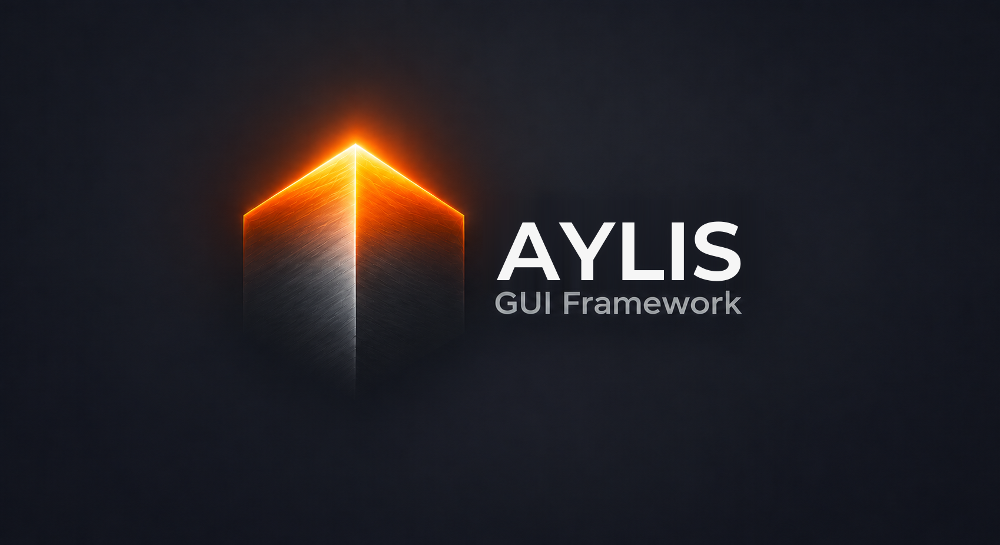

  

# Aylis

O Aylis é uma ferramenta para criar aplicativos com tela: você desenha os formulários,
arrasta os componentes, ajusta as propriedades e escreve só o que acontece quando o usuário
clica, digita ou escolhe algo.

O mesmo aplicativo roda no **Windows**, no **Linux**, no **macOS**, no **Android**, no
**iOS** e no **navegador**, com a mesma aparência em todos.

## O que ele oferece

- **Uma IDE completa**, feita com o próprio Aylis: paleta de componentes, designer de
  formulários, inspetor de propriedades e eventos, editor de código, depurador e publicação
  para cada plataforma.
- **Centenas de componentes prontos**: os de formulário (botões, campos, listas, abas), grades
  de dados, gráficos, relatórios, mapas, vídeo e áudio, câmera, 3D, animações, Markdown,
  documentos (PDF, Word, Excel) e controles industriais.
- **Visual moderno e personalizável**: temas claros e escuros, estilos Material, iOS e outros,
  e a possibilidade de criar o seu.
- **Telas que se ajustam sozinhas**: alinhamento, âncoras e margens fazem o formulário se
  adaptar a qualquer tamanho de janela ou de celular.
- **Dados sem complicação**: os componentes de dados guardam, filtram e mostram os registros, e
  as alterações vão para o servidor do seu jeito.
- **Sua linguagem preferida**: o código do aplicativo pode ser escrito em Rust, Python,
  TypeScript, C#, Java, Go, C++ ou Free Pascal, com o mesmo formulário.
- **Aplicativos leves**: o aplicativo final leva só o que usa.
- **Assistente de IA integrado**: a IDE conversa com o Claude, que pode montar telas, escrever
  e corrigir o código junto com você.

## Exemplos

O projeto traz aplicativos de exemplo, como uma calculadora, um editor de desenho, um player de
vídeo, um painel com os dados dos estados e municípios do Brasil e um ERP com mais de mil
telas, além de uma galeria com todos os componentes.

## Documentação

A [documentação](docs/README.md) explica como o Aylis funciona, passo a passo, com tutoriais e
a descrição de cada componente.

## Situação

O Aylis começou em 25/10/2026 e está em desenvolvimento ativo. Sugestões e relatos de problemas
são bem-vindos.

## Licença

[MIT](LICENSE): pode usar, modificar e distribuir à vontade, inclusive em aplicativos
comerciais.
