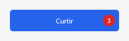
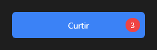

# Seu primeiro componente

Um botão que conta os cliques e mostra o número num selo. Em vez de começar do zero, ele
"herda" do `Button`: o texto, o estilo do tema, o hover, o foco e o `on_click` vêm do botão, e
você escreve só o que é novo.



Componentes são escritos em Rust e vão para a paleta da IDE num pacote; quem usa o pacote
pode programar o app em qualquer linguagem.

## 1. Crie o pacote

Um pacote de componente é um crate Rust com um `package.json` ao lado. Crie a pasta
`BotaoContador` com estes dois arquivos. O `Cargo.toml`:

<!-- incluir: examples/pacotes/BotaoContador/Cargo.toml -->

E o `package.json`:

<!-- incluir: examples/pacotes/BotaoContador/package.json -->

O `package.json` diz à IDE o nome do pacote, a classe (`CounterButton`), em que aba da paleta
ela aparece e as propriedades que o Object Inspector mostra.

## 2. Escreva o componente

O `src/lib.rs` inteiro:

<!-- incluir: examples/pacotes/BotaoContador/src/lib.rs -->

O que importa nele:

- **`inner` e `inner_mut`** devolvem o botão guardado: tudo o que você não sobrescreve vai
  para ele. É a "herança".
- **`properties!`** declara só a propriedade nova, `count`; `text` e as outras já são do
  botão.
- **`click`** conta e depois chama `self.button.click(ctx)`, o `inherited`: sem essa linha,
  o `on_click` de quem usa o botão deixaria de disparar. O `click` vale para o mouse e para o
  teclado (Enter e espaço com o foco no botão).
- **`paint`** deixa o botão se desenhar e põe o selo por cima.

## 3. Teste

O teste no fim do arquivo clica três vezes e confere a contagem, o `on_click` e o texto
herdado do botão:

```bash
cargo test -p counter-button-aylis
```

## 4. Empacote e use na IDE

```bash
aylis-tool pack-code examples/pacotes/BotaoContador --name BotaoContador --component CounterButton --out BotaoContador.aylispkg
```

Na IDE, **Ferramentas → Pacotes de componentes → Instalar pacote…** e escolha o
`BotaoContador.aylispkg`. O `CounterButton` aparece na aba **Standard** da paleta: arraste para
um form, mude o `text` no Object Inspector e ligue o `on_click` como num botão comum.



O pacote pronto está no repositório, em `examples/pacotes/BotaoContador`.

## Próximos passos

- [Manual: criar um componente](criar-componente.md): os outros jeitos (um subtipo só de
  estilo, a pintura por instância, um componente do zero, com filhos ou não visual).
- [Seu primeiro projeto](tutorial-primeiro-projeto.md), se ainda não fez.
