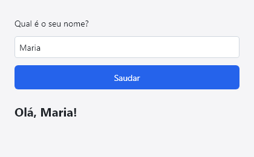
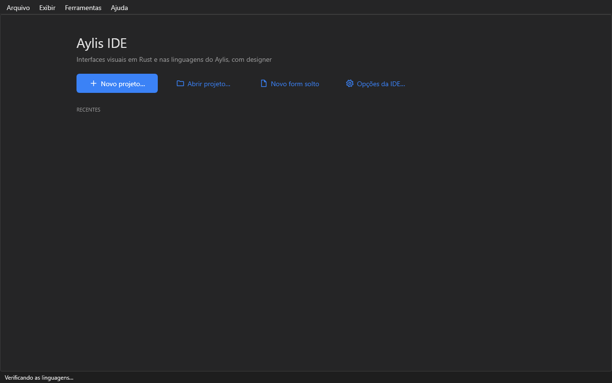
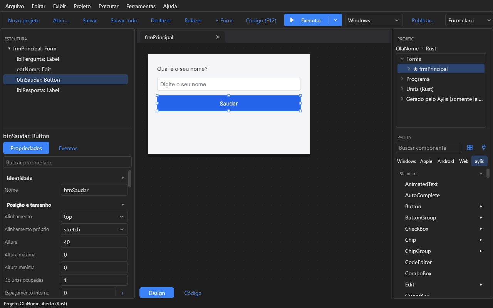

# Seu primeiro projeto

Em uns dez minutos: uma tela que pergunta o seu nome e responde "Olá, …!". Você vai criar o
projeto, montar a tela no designer, ligar o clique do botão e executar.



## 1. Instale a IDE

Baixe o instalador nas [versões do Aylis](https://github.com/e-rust/aylis/releases) e abra a
IDE. Em **Ferramentas → Verificar ambiente**, ela confere o que falta para compilar (o Rust,
ou a ferramenta da linguagem que você escolher).

## 2. Crie o projeto

Na tela inicial, clique em **Novo projeto…**, dê o nome `OlaNome` e escolha a linguagem
(Rust, Python, TypeScript, C#, Java, Go, C++ ou Free Pascal). A IDE cria a pasta do projeto
com um form vazio, o `frmPrincipal`, e abre o designer.



## 3. Monte a tela

Da **Paleta**, à direita, arraste para o form, nesta ordem: um `Label`, um `Edit`, um
`Button` e outro `Label`. Depois, com cada um escolhido, ajuste no **Object Inspector**, à
esquerda:

| Componente | Nome | Propriedades |
|---|---|---|
| Label | `lblPergunta` | `text` = Qual é o seu nome? |
| Edit | `edtNome` | `placeholder` = Digite o seu nome |
| Button | `btnSaudar` | `text` = Saudar |
| Label | `lblResposta` | `font_size` = 20, `bold` ligado |

Em todos, `align` = `top`: um fica embaixo do outro, na largura do form.



## 4. Ligue o clique

Dê dois cliques no botão **Saudar**, no designer. A IDE cria o handler `btn_saudar_click`,
liga ao evento `on_click` do botão e abre o código no lugar dele (**F12** alterna entre o
designer e o código).

## 5. Escreva o código

O handler lê o nome do `Edit` e escreve a saudação no `Label`. Escolha a sua linguagem:

```rust
// rust/src/forms/principal.rs
impl FrmPrincipal {
    pub fn btn_saudar_click(&mut self, ui: &mut Ui, _sender: ComponentId, _args: &EventArgs) {
        let nome = self.edtNome.text(ui);
        self.lblResposta.set_text(ui, format!("Olá, {nome}!"));
    }
}
```

```python
# python/src/forms/principal.py
def btn_saudar_click(aylis, event):
    nome = frmPrincipal.edtNome.text
    frmPrincipal.lblResposta.text = f"Olá, {nome}!"
```

```typescript
// typescript/src/forms/principal.ts
export async function btn_saudar_click(aylis: Aylis, ev: AylisEvent) {
    const nome = await frmPrincipal.edtNome.text;
    frmPrincipal.lblResposta.text = `Olá, ${nome}!`;
}
```

```csharp
// csharp/src/forms/FrmPrincipal.cs
public static void btn_saudar_click(Aylis aylis, AylisEvent ev)
{
    frmPrincipal.lblResposta.Text = $"Olá, {frmPrincipal.edtNome.Text}!";
}
```

```java
// java/src/forms/FrmPrincipal.java
public static void btn_saudar_click(Aylis aylis, Aylis.Event ev) {
    frmPrincipal.lblResposta.setText("Olá, " + frmPrincipal.edtNome.getText() + "!");
}
```

```go
// go/src/forms/principal.go
func (f FrmPrincipal) btn_saudar_click(app *aylis.Aylis, ev aylis.Event) {
	frmPrincipal.lblResposta.SetText("Olá, " + frmPrincipal.edtNome.Text() + "!")
}
```

```cpp
// cpp/src/forms/principal.cpp
void btn_saudar_click(aylis::Aylis& app, const aylis::Event& ev) {
    frmPrincipal.lblResposta.set_text("Olá, " + frmPrincipal.edtNome.text() + "!");
}
```

```pascal
{ pascal/src/forms/principal.pas }
procedure TFrmPrincipal.btn_saudar_click(Sender: TAylisComponent; Event: TJSONObject);
begin
  frmPrincipal.lblResposta.Text := 'Olá, ' + frmPrincipal.edtNome.Text + '!';
end;
```

Os nomes `edtNome` e `lblResposta` vêm do form: a IDE gera o acesso tipado a cada
componente, então um nome errado é erro de compilação, não uma falha na hora de rodar.

## 6. Execute

Aperte **F9**. A IDE gera o código, verifica o projeto, compila e abre o app. Digite um nome
e clique em **Saudar**.


O projeto pronto está no repositório, em `examples/OlaNome` (com um detalhe a mais: sem nome,
ele saúda o mundo).

## Próximos passos

- [Seu primeiro componente](tutorial-componente.md): um botão novo, feito a partir do
  `Button`.
- [Como o Aylis funciona](funcionamento.md): componentes, layout, eventos e temas.
- [Gravar as alterações no banco](gravar-alteracoes.md): telas de cadastro com o
  `ClientDataSet`.
