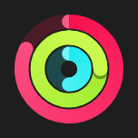

# ActivityRings



Os anéis de atividade da Apple: até três valores (`values`, frações; passando de 1 dá outra volta, com a sombra na ponta), por fora vermelho (Mover), verde (Exercício) e azul (Em pé). `ring_colors` troca as cores (`#FF0000;#00AA00;#0066FF`; vazio = as da Apple); o `accent_color` troca a do anel de fora.

**Paleta:** Additional · **controle visual** · também tem as [propriedades e eventos comuns a todo controle](controles.md)

## Propriedades

### Aparência

| Propriedade | No Object Inspector | Tipo |
|---|---|---|
| `ring_colors` | Cores dos anéis | texto |

### Dados

| Propriedade | No Object Inspector | Tipo |
|---|---|---|
| `values` | Valores | texto |

## Em código

No form, o `ActivityRings1` com o evento ligado (no Object Inspector, na aba Eventos):

```json
{ "class": "ActivityRings", "name": "ActivityRings1" }
```

E o handler, um método do form (`self.ActivityRings1` já é um `ActivityRings`):

```rust
impl FrmPrincipal {
    pub fn form_show(&mut self, ui: &mut Ui, _sender: ComponentId, _args: &EventArgs) {
        let atual = self.ActivityRings1.values(ui);
        self.ActivityRings1.set_values(ui, format!("{atual}!"));
    }
}
```

(Sem eventos próprios: o exemplo usa o `on_show` do form.)
