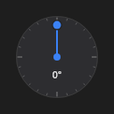

# AngleDial



Relógio de ângulo (o do DevTools): arraste o ponteiro; com Shift, ele anda de `snap` em `snap` graus. 0° aponta para cima e o ângulo cresce no sentido horário, como no `rotate()` e nos gradientes do CSS. Setas e roda do mouse andam 1° (com Shift, `snap`).

**Paleta:** Additional · **controle visual** · também tem as [propriedades e eventos comuns a todo controle](controles.md)

## Propriedades

### Aparência

| Propriedade | No Object Inspector | Tipo | O que faz |
|---|---|---|---|
| `show_value` | Mostra o valor | lógico | Mostra o valor no meio (quando o relógio tem espaço). |

### Comportamento

| Propriedade | No Object Inspector | Tipo | O que faz |
|---|---|---|---|
| `snap` | Passo com Shift | número | Passo com Shift, em graus. |

### Dados

| Propriedade | No Object Inspector | Tipo | O que faz |
|---|---|---|---|
| `angle` | Ângulo | ângulo (graus) | O ângulo em graus: 0 aponta para cima e cresce no sentido horário. |

## Eventos

| Evento | Quando | No Object Inspector | Pergunta |
|---|---|---|---|
| `on_change` | o valor mudou (pelo usuário ou pelo código) | — |  |
| `on_commit` | — | — |  |

## Em código

No form, o `AngleDial1` com o evento ligado (no Object Inspector, na aba Eventos):

```json
{ "class": "AngleDial", "name": "AngleDial1", "on_change": "angle_dial1_change" }
```

E o handler, um método do form (`self.AngleDial1` já é um `AngleDial`):

```rust
impl FrmPrincipal {
    pub fn angle_dial1_change(&mut self, ui: &mut Ui, _sender: ComponentId, _args: &EventArgs) {
        let atual = self.AngleDial1.snap(ui);
        self.AngleDial1.set_snap(ui, atual + 10.0);
    }
}
```
