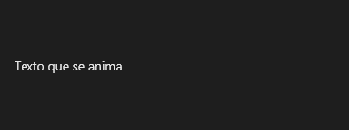

# AnimatedText



Texto com efeitos animados (entrada, saída, contínuos), por letra, palavra ou linha. para a lista de efeitos.

**Paleta:** Standard · **controle visual** · também tem as [propriedades e eventos comuns a todo controle](controles.md)

## Propriedades

### Aparência

| Propriedade | No Object Inspector | Tipo | O que faz |
|---|---|---|---|
| `text` | Texto | texto | O texto animado (as quebras de linha valem). |
| `h_align` | Alinhamento horizontal | um de: `leading`, `center`, `trailing`, `justify` | O alinhamento do texto na horizontal. |
| `v_align` | Alinhamento vertical | um de: `leading`, `center`, `trailing`, `justify` | O alinhamento do texto na vertical. |
| `wrap` | Quebra de linha | lógico | Quebra as linhas na largura do controle (as quebras do texto sempre valem). |

### Comportamento

| Propriedade | No Object Inspector | Tipo | O que faz |
|---|---|---|---|
| `effects` | Efeitos | texto | Os efeitos, separados por `;`: o nome e os parâmetros (`fade by=letter duration=500; wave amplitude=6 after`). Vazio: o texto parado. |
| `autoplay` | Toca sozinho | lógico | Começa a animar quando aparece. |
| `looping` | Repetindo | lógico | Repete a animação ao terminar, depois de `loop_delay`. |
| `loop_delay` | Pausa entre repetições | número | Espera entre uma volta e outra (ms). |

## Eventos

| Evento | Quando | No Object Inspector | Pergunta |
|---|---|---|---|
| `on_finish` | — | — |  |

## Em código

No form, o `AnimatedText1` com o evento ligado (no Object Inspector, na aba Eventos):

```json
{ "class": "AnimatedText", "name": "AnimatedText1", "on_finish": "animated_text1_finish" }
```

E o handler, um método do form (`self.AnimatedText1` já é um `AnimatedText`):

```rust
impl FrmPrincipal {
    pub fn animated_text1_finish(&mut self, ui: &mut Ui, _sender: ComponentId, _args: &EventArgs) {
        let atual = self.AnimatedText1.text(ui);
        self.AnimatedText1.set_text(ui, format!("{atual}!"));
    }
}
```
