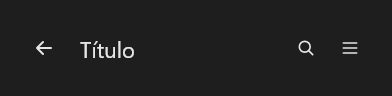

# AppBar



Barra do topo (a "top app bar" do Material 3, a "navigation bar" do iOS): título, botão de navegação à esquerda (`nav_icon`: `arrow-left`, `menu`; no iOS com `back_text`) e ações à direita (`actions`: ícones separados por `;`). `on_nav` e `on_action` (índice da ação).

**Paleta:** Layouts · **controle visual** · também tem as [propriedades e eventos comuns a todo controle](controles.md)

## Propriedades

### Aparência

| Propriedade | No Object Inspector | Tipo |
|---|---|---|
| `title` | Título | texto |
| `subtitle` | Subtítulo | texto |
| `size` | Tamanho | um de: `small`, `center`, `medium`, `large` |
| `nav_icon` | Ícone de navegação | texto |
| `back_text` | Texto do voltar | texto |
| `actions` | Ações | texto |

## Eventos

| Evento | Quando | No Object Inspector | Pergunta |
|---|---|---|---|
| `on_nav` | — | — |  |
| `on_action` | — | — |  |

## Em código

No form, o `AppBar1` com o evento ligado (no Object Inspector, na aba Eventos):

```json
{ "class": "AppBar", "name": "AppBar1", "on_nav": "app_bar1_nav" }
```

E o handler, um método do form (`self.AppBar1` já é um `AppBar`):

```rust
impl FrmPrincipal {
    pub fn app_bar1_nav(&mut self, ui: &mut Ui, _sender: ComponentId, _args: &EventArgs) {
        let atual = self.AppBar1.title(ui);
        self.AppBar1.set_title(ui, format!("{atual}!"));
    }
}
```
