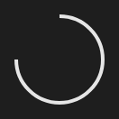

# Arc



Arco (só o traço) da elipse do controle, de `start_angle` a `end_angle`.

**Paleta:** Shapes · **controle visual** · também tem as [propriedades e eventos comuns a todo controle](controles.md)

## Propriedades

### Aparência

| Propriedade | No Object Inspector | Tipo |
|---|---|---|
| `stroke` | Cor do traço | cor |
| `stroke_width` | Largura do traço | número |
| `start_angle` | Ângulo inicial | ângulo (graus) |
| `end_angle` | Ângulo final | ângulo (graus) |

## Em código

No form, o `Arc1` com o evento ligado (no Object Inspector, na aba Eventos):

```json
{ "class": "Arc", "name": "Arc1" }
```

E o handler, um método do form (`self.Arc1` já é um `Arc`):

```rust
impl FrmPrincipal {
    pub fn form_show(&mut self, ui: &mut Ui, _sender: ComponentId, _args: &EventArgs) {
        let atual = self.Arc1.stroke_width(ui);
        self.Arc1.set_stroke_width(ui, atual + 10.0);
    }
}
```

(Sem eventos próprios: o exemplo usa o `on_show` do form.)
