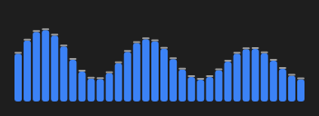

# AudioSpectrum



O visualizador de áudio.

**Paleta:** Media · **controle visual** · também tem as [propriedades e eventos comuns a todo controle](controles.md)

## Propriedades

### Aparência

| Propriedade | No Object Inspector | Tipo | O que faz |
|---|---|---|---|
| `bands` | Barras | inteiro | Quantas barras (4 a 256). |
| `peaks` | Picos | lógico | Os picos que caem devagar por cima das barras. |
| `gap` | Espaço entre itens | número | O vão entre as barras, em pontos. |

### Comportamento

| Propriedade | No Object Inspector | Tipo | O que faz |
|---|---|---|---|
| `source` | Origem | componente | De onde vem o som: um `MediaPlayer`, um `VideoPlayer` ou um `Microphone`. |

## Em código

No form, o `AudioSpectrum1` com o evento ligado (no Object Inspector, na aba Eventos):

```json
{ "class": "AudioSpectrum", "name": "AudioSpectrum1" }
```

E o handler, um método do form (`self.AudioSpectrum1` já é um `AudioSpectrum`):

```rust
impl FrmPrincipal {
    pub fn form_show(&mut self, ui: &mut Ui, _sender: ComponentId, _args: &EventArgs) {
        let atual = self.AudioSpectrum1.bands(ui);
        self.AudioSpectrum1.set_bands(ui, atual + 1);
    }
}
```

(Sem eventos próprios: o exemplo usa o `on_show` do form.)

## Mais sobre o AudioSpectrum

### Ligar a um player

Ponha o `source` num `MediaPlayer`, num `VideoPlayer` ou num `Microphone`. O espectro ouve
antes do volume (fica igual em qualquer volume e no mudo) e acompanha o player quando o
arquivo muda. Parado, as barras descem e os quadros param.

As cores são as do tema (`primary` nas barras, `text_muted` nos picos); o `accent_color` do
controle troca a das barras.
