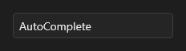

# AutoComplete



Campo com sugestões. `items` são as opções (separadas por `;`); a lista abre ao digitar, filtrando por trecho (sem diferenciar maiúsculas e acentos). Setas escolhem, Enter confirma, Esc fecha. `strict` só aceita um dos itens (o resto é apagado ao sair). `on_select` quando um item é escolhido.

**Paleta:** Standard · **controle visual** · também tem as [propriedades e eventos comuns a todo controle](controles.md)

## Propriedades

### Aparência

| Propriedade | No Object Inspector | Tipo |
|---|---|---|
| `max_rows` | Máximo de linhas | inteiro |
| `placeholder` | Texto de exemplo | texto |
| `border` | Borda | lógico |
| `icon` | Ícone | texto |
| `label` | Rótulo | texto |
| `helper` | Texto de ajuda | texto |
| `counter` | Contador | lógico |
| `prefix` | Prefixo | texto |
| `suffix` | Sufixo | texto |

### Comportamento

| Propriedade | No Object Inspector | Tipo |
|---|---|---|
| `strict` | Só da lista | lógico |
| `max_length` | Tamanho máximo | inteiro |
| `read_only` | Somente leitura | lógico |
| `password` | Senha (esconde o texto) | lógico |
| `sensitive` | Dado pessoal (LGPD: mascarado nas gravações) | lógico |
| `clear_button` | Botão de limpar | lógico |
| `mask` | Máscara | texto |
| `rules` | Regras de validação | texto |
| `spellcheck` | Corretor ortográfico | lógico |
| `autocomplete` | Completar sozinho | lógico |
| `language` | Idioma | texto |
| `keyboard_suggestions` | Sugestões do teclado | lógico |

### Cursor

| Propriedade | No Object Inspector | Tipo |
|---|---|---|
| `caret_color` | Cor do cursor | cor |
| `caret_width` | Largura do cursor | número |
| `caret_style` | Forma do cursor | um de: `line`, `block`, `underline` |
| `caret_blink` | Piscar do cursor (ms) | duração (ms) |

### Dados

| Propriedade | No Object Inspector | Tipo |
|---|---|---|
| `items` | Itens | texto |
| `text` | Texto | texto |
| `error` | Erro | texto |

### Teclado

| Propriedade | No Object Inspector | Tipo |
|---|---|---|
| `allowed_chars` | Caracteres permitidos | texto |
| `blocked_chars` | Caracteres bloqueados | texto |
| `only_allowed` | Só os permitidos | lógico |
| `char_map` | Trocas de caracteres | texto |
| `char_case` | Maiúsculas e minúsculas | um de: `normal`, `upper`, `lower` |

### Texto

| Propriedade | No Object Inspector | Tipo |
|---|---|---|
| `h_align` | Alinhamento horizontal | um de: `leading`, `center`, `trailing`, `justify` |
| `v_align` | Alinhamento vertical | um de: `leading`, `center`, `trailing`, `justify` |
| `wrap` | Quebra de linha | lógico |
| `trimming` | Reticências | um de: `none`, `character`, `word` |

## Eventos

| Evento | Quando | No Object Inspector | Pergunta |
|---|---|---|---|
| `on_select` | — | — |  |
| `on_change` | o valor mudou (pelo usuário ou pelo código, como na VCL) | — |  |
| `on_caret_move` | — | — |  |

## Em código

No form, o `AutoComplete1` com o evento ligado (no Object Inspector, na aba Eventos):

```json
{ "class": "AutoComplete", "name": "AutoComplete1", "on_select": "auto_complete1_select" }
```

E o handler, um método do form (`self.AutoComplete1` já é um `AutoComplete`):

```rust
impl FrmPrincipal {
    pub fn auto_complete1_select(&mut self, ui: &mut Ui, _sender: ComponentId, _args: &EventArgs) {
        let atual = self.AutoComplete1.items(ui);
        self.AutoComplete1.set_items(ui, format!("{atual}!"));
    }
}
```
