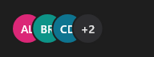

# AvatarGroup



Avatares empilhados (o `v-avatar-group`): as iniciais de `names` (separados por `;`) sobrepostas; passando de `max`, o último mostra "+N".

**Paleta:** Additional · **controle visual** · também tem as [propriedades e eventos comuns a todo controle](controles.md)

## Propriedades

### Aparência

| Propriedade | No Object Inspector | Tipo | O que faz |
|---|---|---|---|
| `max` | Máximo | inteiro |  |
| `size` | Tamanho | número |  |

### Dados

| Propriedade | No Object Inspector | Tipo | O que faz |
|---|---|---|---|
| `names` | Nomes | texto |  |

## Em código

No form, o `AvatarGroup1` com o evento ligado (no Object Inspector, na aba Eventos):

```json
{ "class": "AvatarGroup", "name": "AvatarGroup1" }
```

E o handler, um método do form (`self.AvatarGroup1` já é um `AvatarGroup`):

```rust
impl FrmPrincipal {
    pub fn form_show(&mut self, ui: &mut Ui, _sender: ComponentId, _args: &EventArgs) {
        let atual = self.AvatarGroup1.names(ui);
        self.AvatarGroup1.set_names(ui, format!("{atual}!"));
    }
}
```

(Sem eventos próprios: o exemplo usa o `on_show` do form.)
