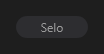

# Badge



Selo (etiqueta, "chip"): um texto curto numa pílula, com ícone ou bolinha opcionais. As variantes `primary`, `success`, `warning`, `danger`, `info` e `outline` mudam a cor.

**Paleta:** Additional · **controle visual** · também tem as [propriedades e eventos comuns a todo controle](controles.md)

## Propriedades

### Aparência

| Propriedade | No Object Inspector | Tipo | O que faz |
|---|---|---|---|
| `text` | Texto | texto | O texto curto do selo; vazio, preso a um `target`, vira uma bolinha. |
| `icon` | Ícone | texto | Ícone pelo nome, antes do texto; vazio: sem ícone. |
| `dot` | Ponto | lógico | Bolinha colorida antes do texto (estado: no ar, gravando...). |

### Posição e tamanho

| Propriedade | No Object Inspector | Tipo | O que faz |
|---|---|---|---|
| `target` | Alvo | componente | O controle irmão em cujo canto o selo fica preso; vazio: fica onde foi posto. |
| `anchor` | Âncora | um de: `top_right`, `top_left`, `bottom_right`, `bottom_left` | O canto do `target` onde o selo fica. |

## Em código

No form, o `Badge1` com o evento ligado (no Object Inspector, na aba Eventos):

```json
{ "class": "Badge", "name": "Badge1" }
```

E o handler, um método do form (`self.Badge1` já é um `Badge`):

```rust
impl FrmPrincipal {
    pub fn form_show(&mut self, ui: &mut Ui, _sender: ComponentId, _args: &EventArgs) {
        let atual = self.Badge1.text(ui);
        self.Badge1.set_text(ui, format!("{atual}!"));
    }
}
```

(Sem eventos próprios: o exemplo usa o `on_show` do form.)
