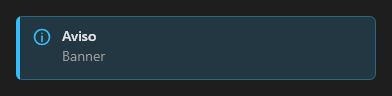

# Banner



Aviso em faixa (alerta): ícone, título e texto, com a cor da variante (`info` padrão, `success`, `warning`, `danger`). Com `closable`, um "×" esconde a faixa e dispara `on_close`.

**Paleta:** Additional · **controle visual** · também tem as [propriedades e eventos comuns a todo controle](controles.md)

## Propriedades

### Aparência

| Propriedade | No Object Inspector | Tipo | O que faz |
|---|---|---|---|
| `title` | Título | texto | O título do aviso, em destaque; vazio: só o texto. |
| `text` | Texto | texto | O texto do aviso, abaixo do título. |
| `icon` | Ícone | texto | Ícone; vazio = o da variante (info, success, warning, error). |

### Comportamento

| Propriedade | No Object Inspector | Tipo | O que faz |
|---|---|---|---|
| `closable` | Pode fechar | lógico | Mostra o "×" que esconde a faixa e dispara o `on_close`. |

## Eventos

| Evento | Quando | No Object Inspector | Pergunta |
|---|---|---|---|
| `on_close` | o form fechou | — |  |

## Em código

No form, o `Banner1` com o evento ligado (no Object Inspector, na aba Eventos):

```json
{ "class": "Banner", "name": "Banner1", "on_close": "banner1_close" }
```

E o handler, um método do form (`self.Banner1` já é um `Banner`):

```rust
impl FrmPrincipal {
    pub fn banner1_close(&mut self, ui: &mut Ui, _sender: ComponentId, _args: &EventArgs) {
        let atual = self.Banner1.title(ui);
        self.Banner1.set_title(ui, format!("{atual}!"));
    }
}
```
