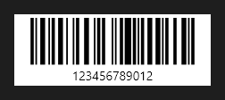

# Barcode



Código de barras ou QR Code: o dado em `text` (no relatório, um campo entre colchetes vira o valor de cada registro), o formato em `format` (`code128`, `ean13`, `ean8`, `upca`, `code39`, `itf`, `qr`; no QR, a correção de erro em `error_correction`). Quem gera é o provedor ligado em `provider` (um formato que o Aylis não tem vem de outro provedor); sem ele, o do Aylis. As barras são escuras sobre o fundo claro mesmo no tema escuro (o leitor precisa do contraste), e `fill` e `text_color` trocam as duas cores.

**Paleta:** Reports · **controle visual** · também tem as [propriedades e eventos comuns a todo controle](controles.md)

## Propriedades

### Aparência

| Propriedade | No Object Inspector | Tipo | O que faz |
|---|---|---|---|
| `show_text` | Mostrar o texto | lógico | O texto legível embaixo das barras (nos códigos de barras; o QR não tem). |

### Dados

| Propriedade | No Object Inspector | Tipo | O que faz |
|---|---|---|---|
| `text` | Texto | texto |  |
| `format` | Formato | texto |  |
| `error_correction` | Correção de erros | um de: `low`, `medium`, `quartile`, `high` | A correção de erro do QR Code (`low`, `medium`, `quartile`, `high`: L, M, Q e H), que vai para o provedor; os códigos de barras não têm. |
| `provider` | Provedor | componente |  |

## Em código

No form, o `Barcode1` com o evento ligado (no Object Inspector, na aba Eventos):

```json
{ "class": "Barcode", "name": "Barcode1" }
```

E o handler, um método do form (`self.Barcode1` já é um `Barcode`):

```rust
impl FrmPrincipal {
    pub fn form_show(&mut self, ui: &mut Ui, _sender: ComponentId, _args: &EventArgs) {
        let atual = self.Barcode1.text(ui);
        self.Barcode1.set_text(ui, format!("{atual}!"));
    }
}
```

(Sem eventos próprios: o exemplo usa o `on_show` do form.)
