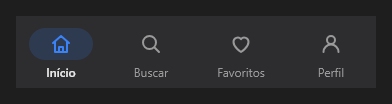

# BottomNavigation



Barra de navegação do rodapé (o `v-bottom-navigation`, a "navigation bar" do Material 3): 3 a 5 destinos com ícone e nome; o escolhido ganha a pílula atrás do ícone.

**Paleta:** Layouts · **controle visual** · também tem as [propriedades e eventos comuns a todo controle](controles.md)

## Propriedades

### Aparência

| Propriedade | No Object Inspector | Tipo |
|---|---|---|
| `icons` | Ícones | texto |

### Dados

| Propriedade | No Object Inspector | Tipo |
|---|---|---|
| `items` | Itens | texto |
| `item_index` | Item escolhido | inteiro |

## Eventos

| Evento | Quando | No Object Inspector | Pergunta |
|---|---|---|---|
| `on_change` | o valor mudou (pelo usuário ou pelo código, como na VCL) | — |  |

## Em código

No form, o `BottomNavigation1` com o evento ligado (no Object Inspector, na aba Eventos):

```json
{ "class": "BottomNavigation", "name": "BottomNavigation1", "on_change": "bottom_navigation1_change" }
```

E o handler, um método do form (`self.BottomNavigation1` já é um `BottomNavigation`):

```rust
impl FrmPrincipal {
    pub fn bottom_navigation1_change(&mut self, ui: &mut Ui, _sender: ComponentId, _args: &EventArgs) {
        let atual = self.BottomNavigation1.items(ui);
        self.BottomNavigation1.set_items(ui, format!("{atual}!"));
    }
}
```
