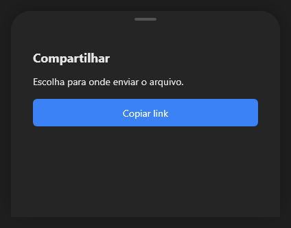

# BottomSheet



Folha que sobe do rodapé (o `v-bottom-sheet`, a "sheet" do iOS): um contêiner com cantos de cima arredondados e a alça; aparece com `open` (na altura `sheet_height`). Com `detents` (alturas: frações do pai, como `0.4;0.9`, ou pontos), arrastar a alça muda a altura e solta encaixando na mais perto; puxar bem para baixo fecha (`on_close`). Coloque os controles dentro.

**Paleta:** Layouts · **controle visual** · também tem as [propriedades e eventos comuns a todo controle](controles.md)

## Propriedades

### Comportamento

| Propriedade | No Object Inspector | Tipo | O que faz |
|---|---|---|---|
| `open` | Aberto | lógico |  |
| `detents` | Alturas de parada | texto |  |

### Posição e tamanho

| Propriedade | No Object Inspector | Tipo | O que faz |
|---|---|---|---|
| `sheet_height` | Altura da folha | número |  |

## Eventos

| Evento | Quando | No Object Inspector | Pergunta |
|---|---|---|---|
| `on_close` | o form fechou | — |  |

## Em código

No form, o `BottomSheet1` com o evento ligado (no Object Inspector, na aba Eventos):

```json
{ "class": "BottomSheet", "name": "BottomSheet1", "on_close": "bottom_sheet1_close" }
```

E o handler, um método do form (`self.BottomSheet1` já é um `BottomSheet`):

```rust
impl FrmPrincipal {
    pub fn bottom_sheet1_close(&mut self, ui: &mut Ui, _sender: ComponentId, _args: &EventArgs) {
        let atual = self.BottomSheet1.open(ui);
        self.BottomSheet1.set_open(ui, !atual);
    }
}
```
