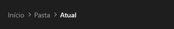

# Breadcrumb



Trilha de navegação ("Início › Vídeos › 2026"): cada parte é clicável e dispara `on_change` com o índice. A última é a atual (em destaque).

**Paleta:** Additional · **controle visual** · também tem as [propriedades e eventos comuns a todo controle](controles.md)

## Propriedades

### Dados

| Propriedade | No Object Inspector | Tipo | O que faz |
|---|---|---|---|
| `items` | Itens | texto | As partes da trilha, separadas por `;`; a última é a atual. |

## Eventos

| Evento | Quando | No Object Inspector | Pergunta |
|---|---|---|---|
| `on_change` | o valor mudou (pelo usuário ou pelo código) | — |  |

## Em código

No form, o `Breadcrumb1` com o evento ligado (no Object Inspector, na aba Eventos):

```json
{ "class": "Breadcrumb", "name": "Breadcrumb1", "on_change": "breadcrumb1_change" }
```

E o handler, um método do form (`self.Breadcrumb1` já é um `Breadcrumb`):

```rust
impl FrmPrincipal {
    pub fn breadcrumb1_change(&mut self, ui: &mut Ui, _sender: ComponentId, _args: &EventArgs) {
        let atual = self.Breadcrumb1.items(ui);
        self.Breadcrumb1.set_items(ui, format!("{atual}!"));
    }
}
```
