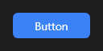

# Button



Botão que dispara uma ação: texto, ícone opcional (à esquerda, à direita ou em cima) e os estilos do tema (contorno, plano, flutuante...). Pode ficar marcado (`checkable`) e, num diálogo, fechar o form com um `modal_result`.

**Paleta:** Standard · **controle visual** · também tem as [propriedades e eventos comuns a todo controle](controles.md)

## Propriedades

### Aparência

| Propriedade | No Object Inspector | Tipo | O que faz |
|---|---|---|---|
| `text` | Texto | texto | O texto do botão; `&` antes de uma letra faz dela o atalho com Alt. Vazio: só o ícone. |
| `icon` | Ícone | texto | Ícone pelo nome (`"play"` ou um registrado com `Ui::register_icon`); vazio: sem ícone. |
| `checked_icon` | Ícone marcado | texto | Ícone quando marcado (vazio = o mesmo `icon`). |
| `icon_position` | Posição do ícone | um de: `left`, `right`, `top` | Onde fica o ícone em relação ao texto: à esquerda, à direita ou em cima. |
| `icon_size` | Tamanho do ícone | número | Tamanho do ícone; 0 = pelo tamanho da fonte (ou do botão, sem texto). |
| `h_align` | Alinhamento horizontal | um de: `leading`, `center`, `trailing`, `justify` | Onde ficam o texto e o ícone: no centro (o padrão), à esquerda ou à direita (o item de um menu lateral, a linha de uma lista de botões). |
| `radius` | Raio dos cantos | número ou lista de números | Raio dos cantos: um número, ou `[cima-esquerda, cima-direita, baixo-direita, baixo-esquerda]`. Negativo curva o canto para fora (a aba que se funde no painel). Vazio: o desenho do tema. |

### Comportamento

| Propriedade | No Object Inspector | Tipo | O que faz |
|---|---|---|---|
| `checkable` | Marcável | lógico | Cada clique alterna o `checked` (um botão de ligar e desligar). |
| `modal_result` | Resultado do modal | um de: `none`, `ok`, `cancel`, `abort`, `retry`, `ignore`, `yes`, `no`, `close` | Num form modal, clicar fecha o form com este resultado: `ok` num "Confirmar", `cancel` num "Cancelar". |
| `repeat_enter` | Repetir com Enter | lógico | O Enter seguro repete o clique (a repetição do teclado). Desligado, só o primeiro Enter clica. |
| `default_button` | Botão padrão (Enter) | lógico | O botão padrão do form: o Enter que nenhum controle usou o clica. |
| `cancel_button` | Botão de cancelar (Esc) | lógico | O botão de cancelar do form: o Esc que nenhum controle usou o clica. |
| `group_index` | Grupo exclusivo | inteiro | Grupo exclusivo: entre os botões `checkable` do mesmo pai com o mesmo número (> 0), marcar um desmarca os outros, e clicar no marcado não desmarca (a aba de uma barra, o modo de uma ferramenta). 0 = sem grupo. |

### Dados

| Propriedade | No Object Inspector | Tipo | O que faz |
|---|---|---|---|
| `checked` | Marcado | lógico | Marcado (afundado), com `checkable`; o tema pinta o estado `checked`. |

## Eventos

| Evento | Quando | No Object Inspector | Pergunta |
|---|---|---|---|
| `on_change` | o valor mudou (pelo usuário ou pelo código) | — |  |

## Em código

No form, o `Button1` com o evento ligado (no Object Inspector, na aba Eventos):

```json
{ "class": "Button", "name": "Button1", "on_change": "button1_change" }
```

E o handler, um método do form (`self.Button1` já é um `Button`):

```rust
impl FrmPrincipal {
    pub fn button1_change(&mut self, ui: &mut Ui, _sender: ComponentId, _args: &EventArgs) {
        let atual = self.Button1.text(ui);
        self.Button1.set_text(ui, format!("{atual}!"));
    }
}
```
