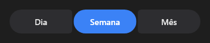

# ButtonGroup



Grupo de botões do Material 3 Expressive: lado a lado (`connected` = colados, com os cantos de dentro pequenos). O escolhido muda de forma (pílula → retângulo arredondado, ou o contrário quando colados). Um (`multiple` desligado) ou vários; `selected` são os itens separados por `;`; `on_change`.

**Paleta:** Standard · **controle visual** · também tem as [propriedades e eventos comuns a todo controle](controles.md)

## Propriedades

### Aparência

| Propriedade | No Object Inspector | Tipo | O que faz |
|---|---|---|---|
| `icons` | Ícones | texto | Os ícones dos botões, na mesma ordem dos `items`, separados por `;`; vazio: só texto. |
| `connected` | Juntos | lógico | Os botões colados, com os cantos de dentro pequenos; desligado, separados. |

### Comportamento

| Propriedade | No Object Inspector | Tipo | O que faz |
|---|---|---|---|
| `multiple` | Vários | lógico | Deixa marcar vários; desligado, marcar um desmarca o outro. |

### Dados

| Propriedade | No Object Inspector | Tipo | O que faz |
|---|---|---|---|
| `items` | Itens | texto | Os textos dos botões, separados por `;` (`Dia;Semana;Mês`). |
| `selected` | Escolhidos | texto | Os botões marcados: os textos, separados por `;` (vazio: nenhum). |

## Eventos

| Evento | Quando | No Object Inspector | Pergunta |
|---|---|---|---|
| `on_change` | o valor mudou (pelo usuário ou pelo código) | — |  |

## Em código

No form, o `ButtonGroup1` com o evento ligado (no Object Inspector, na aba Eventos):

```json
{ "class": "ButtonGroup", "name": "ButtonGroup1", "on_change": "button_group1_change" }
```

E o handler, um método do form (`self.ButtonGroup1` já é um `ButtonGroup`):

```rust
impl FrmPrincipal {
    pub fn button_group1_change(&mut self, ui: &mut Ui, _sender: ComponentId, _args: &EventArgs) {
        let atual = self.ButtonGroup1.items(ui);
        self.ButtonGroup1.set_items(ui, format!("{atual}!"));
    }
}
```
