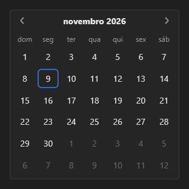

# Calendar



Calendário de um mês: clique num dia escolhe; ‹ › trocam o mês; setas andam pelos dias, PageUp/PageDown pelos meses. `on_change` traz a data ISO.

**Paleta:** Additional · **controle visual** · também tem as [propriedades e eventos comuns a todo controle](controles.md)

## Propriedades

### Comportamento

| Propriedade | No Object Inspector | Tipo |
|---|---|---|
| `range` | Intervalo de datas | lógico |
| `month_mode` | Escolhendo o mês | lógico |

### Dados

| Propriedade | No Object Inspector | Tipo |
|---|---|---|
| `date` | Data | texto |
| `end_date` | Data final | texto |
| `events` | Eventos | texto |

## Eventos

| Evento | Quando | No Object Inspector | Pergunta |
|---|---|---|---|
| `on_change` | o valor mudou (pelo usuário ou pelo código, como na VCL) | — |  |

## Em código

No form, o `Calendar1` com o evento ligado (no Object Inspector, na aba Eventos):

```json
{ "class": "Calendar", "name": "Calendar1", "on_change": "calendar1_change" }
```

E o handler, um método do form (`self.Calendar1` já é um `Calendar`):

```rust
impl FrmPrincipal {
    pub fn calendar1_change(&mut self, ui: &mut Ui, _sender: ComponentId, _args: &EventArgs) {
        let atual = self.Calendar1.date(ui);
        self.Calendar1.set_date(ui, format!("{atual}!"));
    }
}
```
