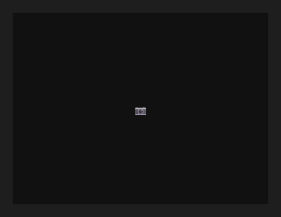

# CameraView



A câmera ao vivo. `active` liga; `camera` escolhe (vazio: a primeira; `front` ou `back`: a da tela ou a de trás, no celular; ou o `id` de `cameras()`, que lista); `mirror` espelha (a câmera frontal costuma parecer mais natural assim).

**Paleta:** Media · **controle visual** · também tem as [propriedades e eventos comuns a todo controle](controles.md)

## Propriedades

### Aparência

| Propriedade | No Object Inspector | Tipo | O que faz |
|---|---|---|---|
| `mirror` | Espelhado | lógico |  |
| `fit` | Ajuste | um de: `contain`, `cover`, `stretch`, `center`, `original` |  |
| `radius` | Raio dos cantos | número |  |

### Comportamento

| Propriedade | No Object Inspector | Tipo | O que faz |
|---|---|---|---|
| `camera` | Câmera | texto |  |
| `active` | Ativo | lógico |  |
| `quality` | Qualidade | um de: `low`, `medium`, `high`, `max` |  |
| `resolution` | Resolução do 3D | texto |  |
| `torch` | Lanterna (flash aceso) | lógico |  |

## Eventos

| Evento | Quando | No Object Inspector | Pergunta |
|---|---|---|---|
| `on_error` | — | — |  |
| `on_ready` | — | — |  |

## Em código

No form, o `CameraView1` com o evento ligado (no Object Inspector, na aba Eventos):

```json
{ "class": "CameraView", "name": "CameraView1", "on_error": "camera_view1_error" }
```

E o handler, um método do form (`self.CameraView1` já é um `CameraView`):

```rust
impl FrmPrincipal {
    pub fn camera_view1_error(&mut self, ui: &mut Ui, _sender: ComponentId, _args: &EventArgs) {
        let atual = self.CameraView1.camera(ui);
        self.CameraView1.set_camera(ui, format!("{atual}!"));
    }
}
```
