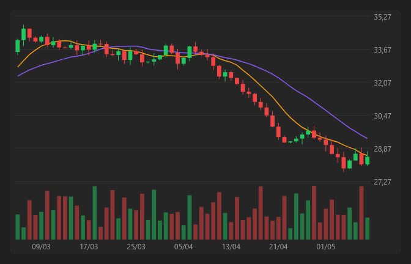

# CandleChart



Gráfico de candles (OHLC) com volume, indicadores e ferramentas de desenho.

**Paleta:** Trader · **controle visual** · também tem as [propriedades e eventos comuns a todo controle](controles.md)

## Propriedades

### Aparência

| Propriedade | No Object Inspector | Tipo |
|---|---|---|
| `lower` | Indicador de baixo | um de: `none`, `volume`, `rsi`, `macd` |
| `volume_profile` | Perfil de volume | lógico |
| `decimals` | Casas decimais | inteiro |

### Comportamento

| Propriedade | No Object Inspector | Tipo |
|---|---|---|
| `indicators` | Indicadores | texto |
| `draw_mode` | Modo de desenho | um de: `pan`, `trend`, `fibonacci` |

### Dados

| Propriedade | No Object Inspector | Tipo |
|---|---|---|
| `data` | Dados | texto |

## Eventos

| Evento | Quando | No Object Inspector | Pergunta |
|---|---|---|---|
| `on_drawing` | — | — |  |

## Em código

No form, o `CandleChart1` com o evento ligado (no Object Inspector, na aba Eventos):

```json
{ "class": "CandleChart", "name": "CandleChart1", "on_drawing": "candle_chart1_drawing" }
```

E o handler, um método do form (`self.CandleChart1` já é um `CandleChart`):

```rust
impl FrmPrincipal {
    pub fn candle_chart1_drawing(&mut self, ui: &mut Ui, _sender: ComponentId, _args: &EventArgs) {
        let atual = self.CandleChart1.data(ui);
        self.CandleChart1.set_data(ui, format!("{atual}!"));
    }
}
```
