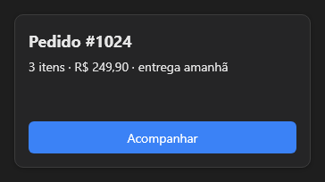

# Card



O cartão (`QCard`): um painel com a cara de cartão do tema (fundo, cantos e sombra), que recebe outros componentes. As variantes `flat` (sem sombra) e `bordered` (com borda).

**Paleta:** Quasar · **controle visual** · também tem as [propriedades e eventos comuns a todo controle](controles.md)

## Propriedades

### Aparência

| Propriedade | No Object Inspector | Tipo | O que faz |
|---|---|---|---|
| `fill2` | Segunda cor do degradê | cor | Segunda cor: com ela, o fundo vira um gradiente de `fill` até `fill2`. |
| `fill_mid` | Cor do meio do degradê | cor | Cor do meio do gradiente (opcional), na posição `fill_mid_at`. |
| `fill_mid_at` | Posição da cor do meio | número | Onde fica a `fill_mid`, de 0 a 1 (0 = no meio). |
| `gradient_angle` | Ângulo do degradê | ângulo (graus) | Direção do gradiente em graus, como no CSS: 0 = para cima, 90 = para a direita. |
| `gradient_radial` | Degradê circular | lógico | Gradiente radial: `fill` no centro até `fill2` na borda (o menor raio do retângulo). |
| `stroke` | Cor do traço | cor |  |
| `stroke_width` | Largura do traço | número |  |
| `radius` | Raio dos cantos | número ou lista de números | Raio dos cantos: um número, ou `[cima-esquerda, cima-direita, baixo-direita, baixo-esquerda]`. Negativo curva o canto para fora (a aba que se funde no painel). Vazio: o do tema. |

### Teclado

| Propriedade | No Object Inspector | Tipo | O que faz |
|---|---|---|---|
| `allowed_chars` | Caracteres permitidos | texto | Os caracteres dos campos dentro do painel (veja o `Form`). |
| `blocked_chars` | Caracteres bloqueados | texto |  |
| `only_allowed` | Só os permitidos | lógico |  |
| `chars_override` | Força os caracteres | lógico |  |
| `char_map` | Trocas de caracteres | texto | Trocas do que o teclado produz nos campos de dentro (`",."`: vírgula por ponto), com a mesma herança dos filtros. |

### Posição e tamanho

| Propriedade | No Object Inspector | Tipo | O que faz |
|---|---|---|---|
| `gap` | Espaço entre itens | número | O vão entre os filhos encaixados (o `gap` do CSS; L05 do Tabernáculo). |

## Em código

No form, o `Card1` com o evento ligado (no Object Inspector, na aba Eventos):

```json
{ "class": "Card", "name": "Card1" }
```

E o handler, um método do form (`self.Card1` já é um `Card`):

```rust
impl FrmPrincipal {
    pub fn form_show(&mut self, ui: &mut Ui, _sender: ComponentId, _args: &EventArgs) {
        let atual = self.Card1.allowed_chars(ui);
        self.Card1.set_allowed_chars(ui, format!("{atual}!"));
    }
}
```

(Sem eventos próprios: o exemplo usa o `on_show` do form.)
