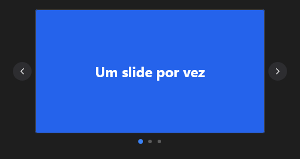

# Carousel



Slides (o `v-carousel` / `v-window`): os controles de dentro, um de cada vez. `index` é o slide; `interval` (ms, 0 = parado) passa sozinho; setas nas laterais (`show_arrows`), bolinhas embaixo e arrastar para os lados. `on_change`.

**Paleta:** Layouts · **controle visual** · também tem as [propriedades e eventos comuns a todo controle](controles.md)

## Propriedades

### Aparência

| Propriedade | No Object Inspector | Tipo | O que faz |
|---|---|---|---|
| `show_arrows` | Mostra as setas | lógico |  |

### Comportamento

| Propriedade | No Object Inspector | Tipo | O que faz |
|---|---|---|---|
| `interval` | Intervalo | duração (ms) |  |
| `cycle` | Circular | lógico |  |

### Dados

| Propriedade | No Object Inspector | Tipo | O que faz |
|---|---|---|---|
| `index` | Índice | inteiro |  |

## Eventos

| Evento | Quando | No Object Inspector | Pergunta |
|---|---|---|---|
| `on_change` | o valor mudou (pelo usuário ou pelo código, como na VCL) | — |  |

## Em código

No form, o `Carousel1` com o evento ligado (no Object Inspector, na aba Eventos):

```json
{ "class": "Carousel", "name": "Carousel1", "on_change": "carousel1_change" }
```

E o handler, um método do form (`self.Carousel1` já é um `Carousel`):

```rust
impl FrmPrincipal {
    pub fn carousel1_change(&mut self, ui: &mut Ui, _sender: ComponentId, _args: &EventArgs) {
        let atual = self.Carousel1.index(ui);
        self.Carousel1.set_index(ui, atual + 1);
    }
}
```
