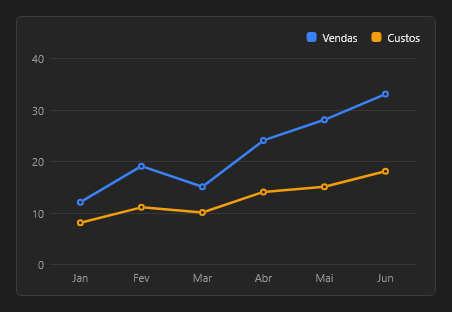

# Chart



Gráfico de linhas, barras, áreas, pizza e outros tipos, com legenda e eixos; as séries vêm por código ou ligadas aos dados.

**Paleta:** Additional · **controle visual** · também tem as [propriedades e eventos comuns a todo controle](controles.md)

## Propriedades

### Aparência

| Propriedade | No Object Inspector | Tipo | O que faz |
|---|---|---|---|
| `kind` | Tipo | um de: `line`, `bar`, `area`, `pie`, `donut`, `sparkline`, `heatmap`, `scatter`, `stacked_bar`, `waterfall`, `funnel`, `treemap`, `radar`, `horizontal_bar`, `bubble`, `polar_area`, `stacked_line`, `stacked_area`, `mixed`, `sankey`, `waffle` | O tipo do gráfico: barras, linhas, área, pizza, rosca, dispersão... |
| `title` | Título | texto | O título em cima do gráfico; vazio: sem título. |
| `legend` | Legenda | lógico | Mostra a legenda com o nome de cada série. |
| `stepped` | Em degraus | lógico | Linhas em degraus. |
| `tension` | Curvatura | número | Linhas suavizadas (0 = retas; até 1), sem passar dos pontos (monotônica). |
| `value_format` | Formato dos números | um de: `short`, `full`, `percent` | Números dos eixos e das dicas: vazio ou `short` (60k, 1.2M), `full` (60.000, com o separador do idioma) ou `percent` (60%). |
| `label_angle` | Ângulo dos rótulos | número | Ângulo dos rótulos do eixo X, em graus (45: inclinados, para nomes longos). |
| `title_align` | Alinhamento do título | um de: `left`, `center`, `right` | Onde fica o título: `left`, `center` ou `right`. |
| `title_bold` | Título em negrito | lógico | O título em negrito. |
| `area_opacity` | Opacidade da área | número | Opacidade do preenchimento das áreas (0 a 1). |
| `legend_position` | Posição da legenda | um de: `top_right`, `top_left`, `top`, `bottom` | Onde fica a legenda: `top_right`, `top_left`, `top` ou `bottom`. |
| `stacked` | Empilhado | lógico | Barras deitadas empilhadas (com o tipo `horizontal_bar`). |
| `colors` | Cores | texto | As cores, em ordem (`#2563EB;#16A34A`): das séries e, na pizza e na rosca, das fatias (sem elas, as fatias usam a paleta do gráfico, não a cor das séries). |
| `center_text` | Texto do centro | texto | O texto no meio da rosca: vazio = o total; `-` = nada; ou um texto (`{total}` vira o total). |
| `slice_labels` | Rótulos das fatias | texto | Os rótulos das fatias: `percent` (dentro), `outside` (nome e percentual fora, com uma linha) ou `none`. |
| `border_width` | Largura da borda | número | A largura da moldura (vazia: a do estilo do tema). |

### Comportamento

| Propriedade | No Object Inspector | Tipo | O que faz |
|---|---|---|---|
| `animate` | Animar | lógico | Animação ao trocar os dados. |
| `zoom` | Zoom | lógico | Roda do mouse aproxima, arrastar anda, duplo clique volta (eixo X). |
| `sync` | Sincronizar com | componente | O `ChartSync` que liga este gráfico a outros pelo eixo X: o mouse aqui move o cursor de todos, e o zoom e a seleção por faixa mudam a janela de todos. |
| `select_range` | Selecionar faixa | lógico | Arrastar no gráfico seleciona uma faixa do eixo X e aproxima nela (com o `sync`, muda a janela dos ligados); duplo clique volta ao eixo todo. Sem ele, com o `zoom`, arrastar anda. |

### Dados

| Propriedade | No Object Inspector | Tipo | O que faz |
|---|---|---|---|
| `labels` | Rótulos | lista de textos (separados por `;`) | Os rótulos do eixo X (ou das fatias), separados por `;` (`Jan;Fev;Mar`). |
| `series` | Séries | lista de `ChartSeries` | As séries, em JSON (`CHART_SERIES`): `[{"name": "Custos", "values": [5, 8, 9], "kind": "line", "right_axis": true, "color": "#EF4444"}]`. |
| `json` | Dados (JSON) | texto | Os dados no formato do Chart.js (vazio: `labels` e `series`). |
| `clicked_series` | Série clicada | inteiro | O último ponto clicado (série e índice; -1 = nenhum). |
| `clicked_index` | Item clicado | inteiro | O índice do último ponto clicado na série (-1 = nenhum). |
| `highlight_index` | Ponto destacado | inteiro | Destaca o ponto (a coluna) deste índice pelo código, com a dica, como o mouse em cima (-1: nenhum; o mouse no gráfico vale mais). |

### Posição e tamanho

| Propriedade | No Object Inspector | Tipo | O que faz |
|---|---|---|---|
| `auto_scale` | Escala automática | lógico | Eixo Y automático; sem ele, de `y_min` a `y_max`. |
| `y_min` | Mínimo do eixo Y | número | O começo do eixo Y quando o `auto_scale` está desligado. |
| `y_max` | Máximo do eixo Y | número | O fim do eixo Y quando o `auto_scale` está desligado. |
| `log_scale` | Escala logarítmica | lógico | Escala logarítmica no eixo Y. |
| `reverse` | Invertido | lógico | Eixo Y invertido (o menor em cima). |
| `time_axis` | Eixo de tempo | lógico | Os rótulos são datas (`2026-10-27`, `2026-10-27 14:30`): o eixo X é de tempo. |

## Eventos

| Evento | Quando | No Object Inspector | Pergunta |
|---|---|---|---|
| `on_hover` | — | — |  |

## Em código

No form, o `Chart1` com o evento ligado (no Object Inspector, na aba Eventos):

```json
{ "class": "Chart", "name": "Chart1", "on_hover": "chart1_hover" }
```

E o handler, um método do form (`self.Chart1` já é um `Chart`):

```rust
impl FrmPrincipal {
    pub fn chart1_hover(&mut self, ui: &mut Ui, _sender: ComponentId, _args: &EventArgs) {
        let atual = self.Chart1.title(ui);
        self.Chart1.set_title(ui, format!("{atual}!"));
    }
}
```
