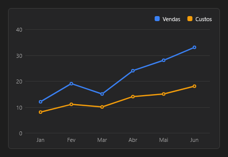

# Chart



Gráfico de linhas, barras, áreas, pizza e outros tipos, com legenda e eixos; as séries vêm por código ou ligadas aos dados.

**Paleta:** Additional · **controle visual** · também tem as [propriedades e eventos comuns a todo controle](controles.md)

## Propriedades

### Aparência

| Propriedade | No Object Inspector | Tipo |
|---|---|---|
| `kind` | Tipo | um de: `line`, `bar`, `area`, `pie`, `donut`, `sparkline`, `heatmap`, `scatter`, `stacked_bar`, `waterfall`, `funnel`, `treemap`, `radar`, `horizontal_bar`, `bubble`, `polar_area`, `stacked_line`, `stacked_area`, `mixed`, `sankey`, `waffle` |
| `title` | Título | texto |
| `legend` | Legenda | lógico |
| `stepped` | Em degraus | lógico |
| `tension` | Curvatura | número |

### Comportamento

| Propriedade | No Object Inspector | Tipo |
|---|---|---|
| `animate` | Animar | lógico |
| `zoom` | Zoom | lógico |

### Dados

| Propriedade | No Object Inspector | Tipo |
|---|---|---|
| `labels` | Rótulos | texto |
| `series` | Séries | texto |
| `json` | Dados (JSON) | texto |
| `clicked_series` | Série clicada | inteiro |
| `clicked_index` | Item clicado | inteiro |

### Posição e tamanho

| Propriedade | No Object Inspector | Tipo |
|---|---|---|
| `auto_scale` | Escala automática | lógico |
| `y_min` | Mínimo do eixo Y | número |
| `y_max` | Máximo do eixo Y | número |
| `log_scale` | Escala logarítmica | lógico |
| `reverse` | Invertido | lógico |
| `time_axis` | Eixo de tempo | lógico |

## Em código

No form, o `Chart1` com o evento ligado (no Object Inspector, na aba Eventos):

```json
{ "class": "Chart", "name": "Chart1" }
```

E o handler, um método do form (`self.Chart1` já é um `Chart`):

```rust
impl FrmPrincipal {
    pub fn form_show(&mut self, ui: &mut Ui, _sender: ComponentId, _args: &EventArgs) {
        let atual = self.Chart1.title(ui);
        self.Chart1.set_title(ui, format!("{atual}!"));
    }
}
```

(Sem eventos próprios: o exemplo usa o `on_show` do form.)
