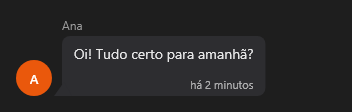

# ChatBubble



O balão de conversa (`QChatMessage`; aqui `ChatBubble`, porque o `ChatMessage` do aylis é a mensagem do `ChatView`): `author` em cima, o `text` (várias linhas), a hora (`stamp`) e as iniciais (ou `avatar`, um arquivo) ao lado. `sent` põe o balão à direita na cor primária (a mensagem de quem usa o app). Para a conversa toda, o `ChatView`.

**Paleta:** Quasar · **controle visual** · também tem as [propriedades e eventos comuns a todo controle](controles.md)

## Propriedades

### Aparência

| Propriedade | No Object Inspector | Tipo | O que faz |
|---|---|---|---|
| `author` | Autor | texto | O nome de quem escreveu, em cima do balão (e as iniciais do avatar). |
| `text` | Texto | texto | A mensagem (pode ter várias linhas). |
| `stamp` | Hora | texto | A hora embaixo do balão (`há 2 minutos`, `14:05`); vazio: sem hora. |
| `sent` | Enviada | lógico | Mensagem de quem usa o app: o balão à direita, na cor primária. |
| `avatar` | Avatar | texto | A foto ao lado do balão (um arquivo do app); vazio: as iniciais do `author`. |

## Em código

No form, o `ChatBubble1` com o evento ligado (no Object Inspector, na aba Eventos):

```json
{ "class": "ChatBubble", "name": "ChatBubble1" }
```

E o handler, um método do form (`self.ChatBubble1` já é um `ChatBubble`):

```rust
impl FrmPrincipal {
    pub fn form_show(&mut self, ui: &mut Ui, _sender: ComponentId, _args: &EventArgs) {
        let atual = self.ChatBubble1.author(ui);
        self.ChatBubble1.set_author(ui, format!("{atual}!"));
    }
}
```

(Sem eventos próprios: o exemplo usa o `on_show` do form.)
