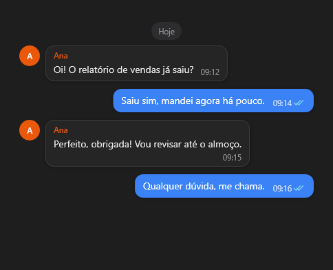

# ChatView



Lista de mensagens de uma conversa (como um app de chat): bolhas à direita para as suas e à esquerda para as dos outros, com nome e avatar no começo de cada sequência, citação de resposta, horário e confirmação de leitura. Só desenha o que está na tela (milhares de mensagens sem custo) e acompanha o fim quando chega mensagem nova, se já estava no fim.

**Paleta:** Additional · **controle visual** · também tem as [propriedades e eventos comuns a todo controle](controles.md)

## Propriedades

### Aparência

| Propriedade | No Object Inspector | Tipo | O que faz |
|---|---|---|---|
| `show_authors` | Mostra os autores | lógico | Nome e avatar dos outros (conversa em grupo). |

## Eventos

| Evento | Quando | No Object Inspector | Pergunta |
|---|---|---|---|
| `on_message_click` | — | — |  |

## Em código

No form, o `ChatView1` com o evento ligado (no Object Inspector, na aba Eventos):

```json
{ "class": "ChatView", "name": "ChatView1", "on_message_click": "chat_view1_message_click" }
```

E o handler, um método do form (`self.ChatView1` já é um `ChatView`):

```rust
impl FrmPrincipal {
    pub fn chat_view1_message_click(&mut self, ui: &mut Ui, _sender: ComponentId, _args: &EventArgs) {
        let atual = self.ChatView1.show_authors(ui);
        self.ChatView1.set_show_authors(ui, !atual);
    }
}
```
