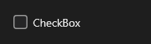

# CheckBox



Caixa de marcação para uma opção de sim ou não ("Lembrar de mim"), com o texto ao lado; clicar no texto também marca.

**Paleta:** Standard · **controle visual** · também tem as [propriedades e eventos comuns a todo controle](controles.md)

## Propriedades

### Aparência

| Propriedade | No Object Inspector | Tipo |
|---|---|---|
| `text` | Texto | texto |
| `box_size` | Tamanho da caixa | número |

### Dados

| Propriedade | No Object Inspector | Tipo |
|---|---|---|
| `checked` | Marcado | lógico |

## Eventos

| Evento | Quando | No Object Inspector | Pergunta |
|---|---|---|---|
| `on_change` | o valor mudou (pelo usuário ou pelo código, como na VCL) | — |  |

## Em código

No form, o `CheckBox1` com o evento ligado (no Object Inspector, na aba Eventos):

```json
{ "class": "CheckBox", "name": "CheckBox1", "on_change": "check_box1_change" }
```

E o handler, um método do form (`self.CheckBox1` já é um `CheckBox`):

```rust
impl FrmPrincipal {
    pub fn check_box1_change(&mut self, ui: &mut Ui, _sender: ComponentId, _args: &EventArgs) {
        let atual = self.CheckBox1.text(ui);
        self.CheckBox1.set_text(ui, format!("{atual}!"));
    }
}
```
