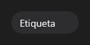

# Chip



Etiqueta compacta (o `v-chip`): texto, ícone opcional, marcável (`checkable`) e com botão de fechar (`closable`, evento `on_close`). Variantes: `outline`, `success`...

**Paleta:** Standard · **controle visual** · também tem as [propriedades e eventos comuns a todo controle](controles.md)

## Propriedades

### Aparência

| Propriedade | No Object Inspector | Tipo | O que faz |
|---|---|---|---|
| `text` | Texto | texto |  |
| `icon` | Ícone | texto |  |

### Comportamento

| Propriedade | No Object Inspector | Tipo | O que faz |
|---|---|---|---|
| `closable` | Pode fechar | lógico |  |
| `checkable` | Marcável | lógico |  |

### Dados

| Propriedade | No Object Inspector | Tipo | O que faz |
|---|---|---|---|
| `checked` | Marcado | lógico |  |

## Eventos

| Evento | Quando | No Object Inspector | Pergunta |
|---|---|---|---|
| `on_close` | o form fechou | — |  |
| `on_change` | o valor mudou (pelo usuário ou pelo código, como na VCL) | — |  |

## Em código

No form, o `Chip1` com o evento ligado (no Object Inspector, na aba Eventos):

```json
{ "class": "Chip", "name": "Chip1", "on_close": "chip1_close" }
```

E o handler, um método do form (`self.Chip1` já é um `Chip`):

```rust
impl FrmPrincipal {
    pub fn chip1_close(&mut self, ui: &mut Ui, _sender: ComponentId, _args: &EventArgs) {
        let atual = self.Chip1.text(ui);
        self.Chip1.set_text(ui, format!("{atual}!"));
    }
}
```
