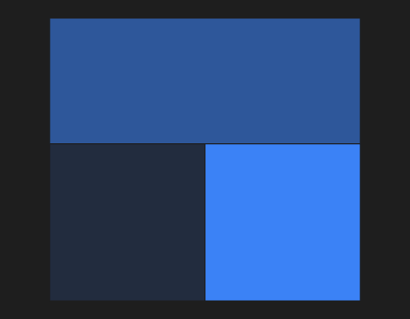

# ChoroplethMap



Mapa coroplético: as regiões de um GeoJSON (`geojson`: o texto ou um arquivo/asset) pintadas pela escala de cor do valor (`values` = `"SP=10;RJ=5"`, pelo nome em `name_property`). Passar o mouse mostra a região e o valor; clique: `on_region_click`.

**Paleta:** BI · **controle visual** · também tem as [propriedades e eventos comuns a todo controle](controles.md)

## Propriedades

### Aparência

| Propriedade | No Object Inspector | Tipo |
|---|---|---|
| `low_color` | Cor do menor valor | cor |
| `high_color` | Cor do maior valor | cor |
| `decimals` | Casas decimais | inteiro |

### Dados

| Propriedade | No Object Inspector | Tipo |
|---|---|---|
| `geojson` | Mapa (GeoJSON) | texto |
| `name_property` | Propriedade do nome | texto |
| `values` | Valores | texto |

## Eventos

| Evento | Quando | No Object Inspector | Pergunta |
|---|---|---|---|
| `on_region_click` | — | — |  |

## Em código

No form, o `ChoroplethMap1` com o evento ligado (no Object Inspector, na aba Eventos):

```json
{ "class": "ChoroplethMap", "name": "ChoroplethMap1", "on_region_click": "choropleth_map1_region_click" }
```

E o handler, um método do form (`self.ChoroplethMap1` já é um `ChoroplethMap`):

```rust
impl FrmPrincipal {
    pub fn choropleth_map1_region_click(&mut self, ui: &mut Ui, _sender: ComponentId, _args: &EventArgs) {
        let atual = self.ChoroplethMap1.geojson(ui);
        self.ChoroplethMap1.set_geojson(ui, format!("{atual}!"));
    }
}
```
