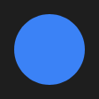

# Circle



Círculo: o maior que cabe, no centro do controle.

**Paleta:** Shapes · **controle visual** · também tem as [propriedades e eventos comuns a todo controle](controles.md)

## Propriedades

### Aparência

| Propriedade | No Object Inspector | Tipo | O que faz |
|---|---|---|---|
| `stroke` | Cor do traço | cor |  |
| `stroke_width` | Largura do traço | número |  |

## Em código

No form, o `Circle1` com o evento ligado (no Object Inspector, na aba Eventos):

```json
{ "class": "Circle", "name": "Circle1" }
```

E o handler, um método do form (`self.Circle1` já é um `Circle`):

```rust
impl FrmPrincipal {
    pub fn form_show(&mut self, ui: &mut Ui, _sender: ComponentId, _args: &EventArgs) {
        let atual = self.Circle1.stroke_width(ui);
        self.Circle1.set_stroke_width(ui, atual + 10.0);
    }
}
```

(Sem eventos próprios: o exemplo usa o `on_show` do form.)
