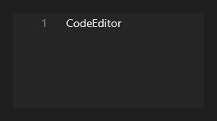

# CodeEditor



Editor de código com realce de sintaxe, números de linha, minimapa e dobra de blocos, para mostrar ou editar código dentro do app.

**Paleta:** Standard · **controle visual** · também tem as [propriedades e eventos comuns a todo controle](controles.md)

## Propriedades

### Aparência

| Propriedade | No Object Inspector | Tipo |
|---|---|---|
| `placeholder` | Texto de exemplo | texto |
| `border` | Borda | lógico |

### Comportamento

| Propriedade | No Object Inspector | Tipo |
|---|---|---|
| `read_only` | Somente leitura | lógico |
| `sensitive` | Dado pessoal (LGPD: mascarado nas gravações) | lógico |
| `max_length` | Tamanho máximo | inteiro |
| `want_tabs` | Aceita Tab | lógico |
| `wheel_lines` | Linhas por rolagem | inteiro |
| `spellcheck` | Corretor ortográfico | lógico |
| `autocomplete` | Completar sozinho | lógico |
| `language` | Idioma | texto |
| `keyboard_suggestions` | Sugestões do teclado | lógico |

### Cursor

| Propriedade | No Object Inspector | Tipo |
|---|---|---|
| `caret_color` | Cor do cursor | cor |
| `caret_width` | Largura do cursor | número |
| `caret_style` | Forma do cursor | um de: `line`, `block`, `underline` |
| `caret_blink` | Piscar do cursor (ms) | duração (ms) |

### Dados

| Propriedade | No Object Inspector | Tipo |
|---|---|---|
| `text` | Texto | texto |

### Teclado

| Propriedade | No Object Inspector | Tipo |
|---|---|---|
| `allowed_chars` | Caracteres permitidos | texto |
| `blocked_chars` | Caracteres bloqueados | texto |
| `only_allowed` | Só os permitidos | lógico |
| `char_map` | Trocas de caracteres | texto |
| `char_case` | Maiúsculas e minúsculas | um de: `normal`, `upper`, `lower` |

### Texto

| Propriedade | No Object Inspector | Tipo |
|---|---|---|
| `h_align` | Alinhamento horizontal | um de: `leading`, `center`, `trailing`, `justify` |
| `wrap` | Quebra de linha | lógico |
| `trimming` | Reticências | um de: `none`, `character`, `word` |
| `syntax` | Linguagem do realce | texto |
| `line_numbers` | Números das linhas | lógico |

## Eventos

| Evento | Quando | No Object Inspector | Pergunta |
|---|---|---|---|
| `on_word_click` | — | — |  |
| `on_complete_request` | — | — |  |
| `on_signature_request` | — | — |  |
| `on_hover_index` | — | — |  |
| `on_change` | o valor mudou (pelo usuário ou pelo código, como na VCL) | — |  |
| `on_caret_move` | — | — |  |
| `on_gutter_click` | — | — |  |
| `on_bookmarks_change` | — | — |  |

## Em código

No form, o `CodeEditor1` com o evento ligado (no Object Inspector, na aba Eventos):

```json
{ "class": "CodeEditor", "name": "CodeEditor1", "on_word_click": "code_editor1_word_click" }
```

E o handler, um método do form (`self.CodeEditor1` já é um `CodeEditor`):

```rust
impl FrmPrincipal {
    pub fn code_editor1_word_click(&mut self, ui: &mut Ui, _sender: ComponentId, _args: &EventArgs) {
        let atual = self.CodeEditor1.text(ui);
        self.CodeEditor1.set_text(ui, format!("{atual}!"));
    }
}
```
