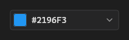

# ColorEdit



Campo de cor (o `v-color-input`): amostra e `#rrggbb`; o clique abre um `ColorPicker` logo abaixo (fecha ao clicar de novo ou ao sair do campo).

**Paleta:** Additional · **controle visual** · também tem as [propriedades e eventos comuns a todo controle](controles.md)

## Propriedades

### Aparência

| Propriedade | No Object Inspector | Tipo |
|---|---|---|
| `alpha` | Transparência (alfa) | lógico |

### Dados

| Propriedade | No Object Inspector | Tipo |
|---|---|---|
| `color` | Cor | cor |

## Eventos

| Evento | Quando | No Object Inspector | Pergunta |
|---|---|---|---|
| `on_change` | o valor mudou (pelo usuário ou pelo código, como na VCL) | — |  |

## Em código

No form, o `ColorEdit1` com o evento ligado (no Object Inspector, na aba Eventos):

```json
{ "class": "ColorEdit", "name": "ColorEdit1", "on_change": "color_edit1_change" }
```

E o handler, um método do form (`self.ColorEdit1` já é um `ColorEdit`):

```rust
impl FrmPrincipal {
    pub fn color_edit1_change(&mut self, ui: &mut Ui, _sender: ComponentId, _args: &EventArgs) {
        let atual = self.ColorEdit1.alpha(ui);
        self.ColorEdit1.set_alpha(ui, !atual);
    }
}
```
