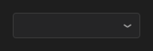

# ComboBox



Lista suspensa: mostra a opção escolhida e abre a lista para trocar. Os itens vêm de `items`, separados por `;`.

**Paleta:** Standard · **controle visual** · também tem as [propriedades e eventos comuns a todo controle](controles.md)

## Propriedades

### Aparência

| Propriedade | No Object Inspector | Tipo |
|---|---|---|
| `arrow` | Seta | um de: `chevron`, `triangle` |

### Comportamento

| Propriedade | No Object Inspector | Tipo |
|---|---|---|
| `sensitive` | Dado pessoal (LGPD: mascarado nas gravações) | lógico |

### Dados

| Propriedade | No Object Inspector | Tipo |
|---|---|---|
| `items` | Itens | texto |
| `values` | Valores | texto |
| `item_index` | Item escolhido | inteiro |

### Texto

| Propriedade | No Object Inspector | Tipo |
|---|---|---|
| `h_align` | Alinhamento horizontal | um de: `leading`, `center`, `trailing`, `justify` |
| `trimming` | Reticências | um de: `none`, `character`, `word` |

## Eventos

| Evento | Quando | No Object Inspector | Pergunta |
|---|---|---|---|
| `on_change` | o valor mudou (pelo usuário ou pelo código, como na VCL) | — |  |

## Em código

No form, o `ComboBox1` com o evento ligado (no Object Inspector, na aba Eventos):

```json
{ "class": "ComboBox", "name": "ComboBox1", "on_change": "combo_box1_change" }
```

E o handler, um método do form (`self.ComboBox1` já é um `ComboBox`):

```rust
impl FrmPrincipal {
    pub fn combo_box1_change(&mut self, ui: &mut Ui, _sender: ComponentId, _args: &EventArgs) {
        let atual = self.ComboBox1.items(ui);
        self.ComboBox1.set_items(ui, format!("{atual}!"));
    }
}
```
