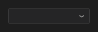

# ComboBox



Lista suspensa: mostra a opção escolhida e abre a lista para trocar. Os itens vêm de `items`, separados por `;`.

**Paleta:** Standard · **controle visual** · também tem as [propriedades e eventos comuns a todo controle](controles.md)

## Propriedades

### Aparência

| Propriedade | No Object Inspector | Tipo | O que faz |
|---|---|---|---|
| `arrow` | Seta | um de: `chevron`, `triangle` | O desenho da seta. |
| `label` | Rótulo | texto | O rótulo do campo (como o do `Edit`); vazio: sem rótulo. |

### Comportamento

| Propriedade | No Object Inspector | Tipo | O que faz |
|---|---|---|---|
| `sensitive` | Dado pessoal (LGPD: mascarado nas gravações) | lógico | Dado pessoal (LGPD): as gravações do `EventRecorder` mascaram o que é digitado aqui, a não ser com o `record_sensitive` dele ligado. Liga e desliga em tempo de execução. |
| `drop_down_count` | Linhas da lista aberta | inteiro | Quantas linhas a lista aberta mostra de uma vez (mínimo 1). Com mais opções, ela rola; sem lugar no form, mostra menos. |
| `clear_button` | Botão de limpar | lógico | O "×" que limpa a escolha, com uma opção escolhida. |

### Dados

| Propriedade | No Object Inspector | Tipo | O que faz |
|---|---|---|---|
| `items` | Itens | lista de textos (separados por `;`) | As opções da lista, separadas por `;`. |
| `values` | Valores | texto | O código de cada opção (`;`); vazio: o código é o próprio texto. |
| `item_index` | Item escolhido | inteiro | A opção escolhida, a partir de 0; -1: nenhuma. |
| `groups` | Grupos das opções | lista de textos (separados por `;`) | O grupo de cada opção (`;`, na ordem de `items`): a lista mostra o nome do grupo, sem clique, antes da primeira opção dele (o `<optgroup>`). Vazio: sem grupos. |
| `disabled_items` | Opções desligadas | lista de textos (separados por `;`) | As opções desligadas, pelos índices (`"2;5"`): aparecem fracas e não se escolhem. |

### Texto

| Propriedade | No Object Inspector | Tipo | O que faz |
|---|---|---|---|
| `h_align` | Alinhamento horizontal | um de: `leading`, `center`, `trailing`, `justify` | Alinhamento do texto escolhido. |
| `trimming` | Reticências | um de: `none`, `character`, `word` | Reticências quando o texto escolhido não couber. |

## Eventos

| Evento | Quando | No Object Inspector | Pergunta |
|---|---|---|---|
| `on_change` | o valor mudou (pelo usuário ou pelo código) | — |  |

## Em código

No form, o `ComboBox1` com o evento ligado (no Object Inspector, na aba Eventos):

```json
{ "class": "ComboBox", "name": "ComboBox1", "on_change": "combo_box1_change" }
```

E o handler, um método do form (`self.ComboBox1` já é um `ComboBox`):

```rust
impl FrmPrincipal {
    pub fn combo_box1_change(&mut self, ui: &mut Ui, _sender: ComponentId, _args: &EventArgs) {
        let atual = self.ComboBox1.values(ui);
        self.ComboBox1.set_values(ui, format!("{atual}!"));
    }
}
```
