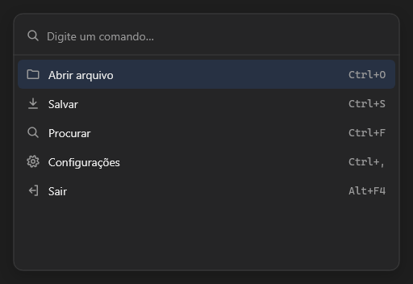

# CommandPalette



Busca de comandos: digite e a lista filtra; setas escolhem, Enter executa (`on_select` com o comando). `items` separados por `;`, cada um `nome|atalho|ícone` (atalho e ícone opcionais).

**Paleta:** Additional · **controle visual** · também tem as [propriedades e eventos comuns a todo controle](controles.md)

## Propriedades

### Aparência

| Propriedade | No Object Inspector | Tipo | O que faz |
|---|---|---|---|
| `placeholder` | Texto de exemplo | texto | O texto apagado da busca vazia. |

### Dados

| Propriedade | No Object Inspector | Tipo | O que faz |
|---|---|---|---|
| `items` | Itens | texto | Os comandos, separados por `;`, cada um `nome\|atalho\|ícone` (atalho e ícone opcionais). |
| `query` | Busca | texto | O texto digitado na busca: a lista mostra só os comandos que o contêm. Vazio: todos. |

## Eventos

| Evento | Quando | No Object Inspector | Pergunta |
|---|---|---|---|
| `on_select` | — | — |  |

## Em código

No form, o `CommandPalette1` com o evento ligado (no Object Inspector, na aba Eventos):

```json
{ "class": "CommandPalette", "name": "CommandPalette1", "on_select": "command_palette1_select" }
```

E o handler, um método do form (`self.CommandPalette1` já é um `CommandPalette`):

```rust
impl FrmPrincipal {
    pub fn command_palette1_select(&mut self, ui: &mut Ui, _sender: ComponentId, _args: &EventArgs) {
        let atual = self.CommandPalette1.items(ui);
        self.CommandPalette1.set_items(ui, format!("{atual}!"));
    }
}
```
