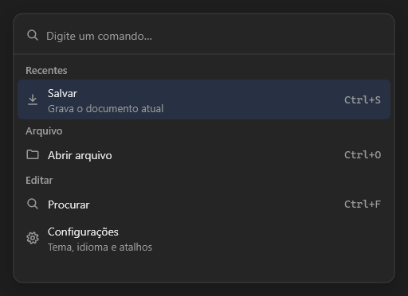

# CommandPalette



Busca de comandos: digite e a lista filtra (sem acento e sem maiúscula, o `fold`); setas escolhem, Enter executa (`on_select` com o `PaletteSelection`: o `id` e o nome do comando). `items` é a lista de registros `PALETTE_COMMAND` (`{"id": "save", "name": "Salvar", "category": "Arquivo", "description": "Grava o documento", "shortcut": "Ctrl+S", "icon": "download"}`; só o nome é obrigatório, e o `id` vazio é o nome). Os comandos de mesma `category` ficam juntos, com o título dela em cima.

**Paleta:** Additional · **controle visual** · também tem as [propriedades e eventos comuns a todo controle](controles.md)

## Propriedades

### Aparência

| Propriedade | No Object Inspector | Tipo | O que faz |
|---|---|---|---|
| `placeholder` | Texto de exemplo | texto | O texto apagado da busca vazia. |

### Comportamento

| Propriedade | No Object Inspector | Tipo | O que faz |
|---|---|---|---|
| `filter` | Filtro | lógico | Filtra o `items` pelo texto da busca (desligado: o app filtra, como na busca no servidor pelo `on_query_change`). |
| `query_delay` | Espera da busca | inteiro | Quantos milissegundos a digitação parada espera antes do `on_query_change`. |
| `max_recent` | Máximo de recentes | inteiro | Quantos recentes a paleta guarda e mostra (0: nenhum). |

### Dados

| Propriedade | No Object Inspector | Tipo | O que faz |
|---|---|---|---|
| `items` | Itens | lista de `PaletteCommand` | Os comandos, em JSON: `[{"id": "save", "name": "Salvar", "category": "Arquivo", "description": "...", "shortcut": "Ctrl+S", "icon": "download"}]`. |
| `query` | Busca | texto | O texto digitado na busca: a lista mostra só os comandos que o contêm (no nome, na descrição ou na categoria). Vazio: todos. |
| `recent` | Recentes | lista de textos (separados por `;`) | Os `id` dos recentes, do mais novo ao mais velho, separados por `;` (o app grava e devolve; o `on_recent_change` avisa quando muda). |

## Eventos

| Evento | Quando | No Object Inspector | Pergunta |
|---|---|---|---|
| `on_select` | — | — |  |
| `on_query_change` | — | — |  |
| `on_recent_change` | — | — |  |

## Em código

No form, o `CommandPalette1` com o evento ligado (no Object Inspector, na aba Eventos):

```json
{ "class": "CommandPalette", "name": "CommandPalette1", "on_select": "command_palette1_select" }
```

E o handler, um método do form (`self.CommandPalette1` já é um `CommandPalette`):

```rust
impl FrmPrincipal {
    pub fn command_palette1_select(&mut self, ui: &mut Ui, _sender: ComponentId, _args: &EventArgs) {
        let atual = self.CommandPalette1.query(ui);
        self.CommandPalette1.set_query(ui, format!("{atual}!"));
    }
}
```
