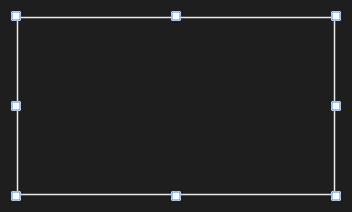

# CropBox



O recorte de uma imagem de `source_width` × `source_height` (pixels da origem; o controle cobre a imagem inteira e escala). A seleção (`sel_x`, `sel_y`, `sel_width`, `sel_height`, em pixels da origem) é o que fica; fora dela a imagem escurece.

**Paleta:** Media · **controle visual** · também tem as [propriedades e eventos comuns a todo controle](controles.md)

## Propriedades

### Aparência

| Propriedade | No Object Inspector | Tipo | O que faz |
|---|---|---|---|
| `caption` | Título | texto | Texto no meio da seleção enquanto arrasta; vazio: "largura×altura". |
| `framed` | Com moldura | lógico | O visual de editor web: terços sempre à vista, alças brancas por fora da moldura e o tamanho em cima (desenha um pouco fora do controle: deixe uns 10 px de margem). |
| `shade` | Sombreamento | cor | A cor de fora da seleção. |

### Comportamento

| Propriedade | No Object Inspector | Tipo | O que faz |
|---|---|---|---|
| `min_size` | Tamanho mínimo | número | O menor lado que a seleção pode ter, em pixels da origem. |
| `snap` | Passo com Shift | número | Arredonda posição e tamanho para múltiplos dele (2 = pares, o que os codificadores de vídeo pedem); 0 ou 1: só para o pixel inteiro. |

### Dados

| Propriedade | No Object Inspector | Tipo | O que faz |
|---|---|---|---|
| `source_width` | Largura da origem | número | Largura da imagem de origem, em pixels (o controle cobre a imagem inteira e escala). |
| `source_height` | Altura da origem | número | Altura da imagem de origem, em pixels. |
| `sel_x` | X da seleção | número | Esquerda da seleção, em pixels da origem. |
| `sel_y` | Y da seleção | número | Topo da seleção, em pixels da origem. |
| `sel_width` | Largura da seleção | número | Largura da seleção, em pixels da origem. |
| `sel_height` | Altura da seleção | número | Altura da seleção, em pixels da origem. |

## Eventos

| Evento | Quando | No Object Inspector | Pergunta |
|---|---|---|---|
| `on_change` | o valor mudou (pelo usuário ou pelo código) | — |  |
| `on_end` | — | — |  |
| `on_tap` | — | — |  |

## Em código

No form, o `CropBox1` com o evento ligado (no Object Inspector, na aba Eventos):

```json
{ "class": "CropBox", "name": "CropBox1", "on_change": "crop_box1_change" }
```

E o handler, um método do form (`self.CropBox1` já é um `CropBox`):

```rust
impl FrmPrincipal {
    pub fn crop_box1_change(&mut self, ui: &mut Ui, _sender: ComponentId, _args: &EventArgs) {
        let atual = self.CropBox1.source_width(ui);
        self.CropBox1.set_source_width(ui, atual + 10.0);
    }
}
```
