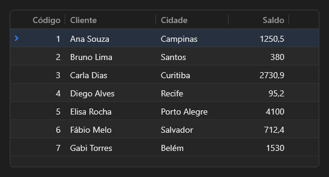

# DataGrid



Grade de registros ligada a um `DataSource`: colunas pelos campos do dataset, edição na célula, ordenação, filtro e milhões de linhas sem travar.

**Paleta:** Data Controls · **controle visual** · também tem as [propriedades e eventos comuns a todo controle](controles.md)

## Propriedades

### Aparência

| Propriedade | No Object Inspector | Tipo | O que faz |
|---|---|---|---|
| `images` | Imagens | componente | O `ImageList` das colunas de ícone (`kind: icon`): o campo diz qual imagem. |
| `row_height` | Altura da linha | número | A altura de cada linha, em pontos. |
| `fixed_columns` | Colunas fixas | inteiro | Quantas colunas da esquerda ficam paradas ao rolar para os lados (0: nenhuma). |
| `cursor_color` | Cor da linha atual | cor | A borda da célula atual; `None` usa a cor de destaque (`primary`) do tema. |
| `indicator` | Coluna indicadora | lógico | A coluna da esquerda com a seta do registro atual; sem ela, a grade começa nos dados. |
| `highlight_current` | Destacar a linha atual | lógico | O fundo destacado na linha do registro atual; sem ele, só a seleção e o passar do mouse. |
| `empty_text` | Texto sem registros | texto | O texto da grade sem registros (vazio: "Sem registros", traduzido). |
| `frame` | Moldura própria | lógico | O fundo e a moldura próprios da grade (o card); desligado, ela pinta só o conteúdo e fica sem a segunda caixa dentro de um `Panel` com borda. |

### Comportamento

| Propriedade | No Object Inspector | Tipo | O que faz |
|---|---|---|---|
| `overscroll` | Fim da rolagem | um de: `auto`, `glow`, `stretch`, `bounce`, `none` | O efeito de fim da rolagem no toque (`auto`: o do sistema; veja `aylis_core::overscroll`). |
| `read_only` | Somente leitura | lógico | Só leitura: as células não editam (mesmo com o dataset editável). |
| `sortable` | Ordenável | lógico | O clique no título ordena pela coluna (de novo: decrescente; na terceira, volta à ordem do dataset); Ctrl+clique junta colunas à ordem. |
| `column_move` | Arrastar colunas | lógico | Arrastar o título muda a ordem das colunas (as fixas trocam só entre si). A nova ordem chega no `on_column_moved` (`ColumnLayout`), no formato de `columns` (com as larguras). |
| `filter_row` | Linha de filtro | lógico | Uma linha embaixo do título para filtrar cada coluna (Enter aplica; vira o `filter` do dataset). |
| `multi_select` | Seleção múltipla | lógico | Seleciona várias linhas: Ctrl+clique marca e desmarca, Shift+clique estende, Ctrl+A seleciona tudo. |
| `incremental_search` | Busca ao digitar | lógico | Digitar procura na coluna atual o primeiro texto que começa com o digitado (em vez de editar a célula). |
| `horizontal_wheel` | Roda na horizontal | um de: `shift`, `always`, `none` | Quando a roda do mouse rola as colunas: `shift` (com o Shift, o padrão dos sistemas), `always` (a roda comum rola as colunas) ou `none` (só o código, pelo `scroll_left`). O movimento de lado do touchpad sempre rola as colunas, menos em `none`. |

### Dados

| Propriedade | No Object Inspector | Tipo | O que faz |
|---|---|---|---|
| `data_source` | Fonte de dados | componente | O `DataSource` de onde vêm os registros. |
| `columns` | Colunas | lista de `ColumnSpec` | As colunas a mostrar, na ordem: a lista de `GRID_COLUMN_RECORD` em JSON (`[{"field": "sigla", "width": 44}, {"field": "nome", "width": 170}, {"field": "regiao"}]`; no form, a lista de objetos). Vazio = todos os campos visíveis. Lida só quando muda (as colunas ficam prontas até a próxima mudança). |
| `footer` | Rodapé | lista de `GridTotal` | O rodapé com totais: a lista de `GRID_TOTAL_RECORD` em JSON (`[{"field": "valor", "function": "sum"}, {"field": "id", "function": "count"}]`; sum, avg, min, max, count), sobre os registros carregados. Vazio: sem rodapé. |

## Eventos

| Evento | Quando | No Object Inspector | Pergunta |
|---|---|---|---|
| `on_error` | — | — |  |
| `on_title_click` | — | — |  |
| `on_selection_change` | — | — |  |
| `on_column_moved` | — | — |  |

## Em código

No form, o `DataGrid1` com o evento ligado (no Object Inspector, na aba Eventos):

```json
{ "class": "DataGrid", "name": "DataGrid1", "on_error": "data_grid1_error" }
```

E o handler, um método do form (`self.DataGrid1` já é um `DataGrid`):

```rust
impl FrmPrincipal {
    pub fn data_grid1_error(&mut self, ui: &mut Ui, _sender: ComponentId, _args: &EventArgs) {
        let atual = self.DataGrid1.row_height(ui);
        self.DataGrid1.set_row_height(ui, atual + 10.0);
    }
}
```

## Mais sobre o DataGrid

### Ícones e imagens nas colunas

Uma coluna com `kind: icon` mostra um ícone do `ImageList` ligado em `images`: o campo do
registro diz qual (a posição ou o nome). Com `kind: image`, a coluna desenha a imagem guardada
no campo (um `blob` com PNG, JPEG...), inteira na altura da linha: para capas maiores, aumente
o `row_height` (a altura de todas as linhas).

```json
{"class": "DataGrid", "name": "grdMusicas", "data_source": "dsMusicas", "images": "imgEstados", "row_height": 56,
 "columns": [{"field": "estado", "kind": "icon", "width": 40}, {"field": "capa", "kind": "image", "width": 64}, {"field": "titulo"}]}
```

Vale nas 8 linguagens: o app só põe o número (ou o nome) e os bytes nos campos.
