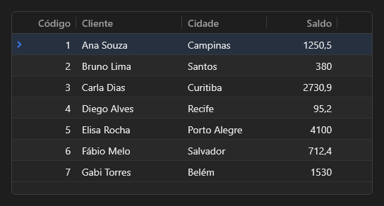

# DataGrid



Grade de registros ligada a um `DataSource`: colunas pelos campos do dataset, edição na célula, ordenação, filtro e milhões de linhas sem travar.

**Paleta:** Data Controls · **controle visual** · também tem as [propriedades e eventos comuns a todo controle](controles.md)

## Propriedades

### Aparência

| Propriedade | No Object Inspector | Tipo | O que faz |
|---|---|---|---|
| `row_height` | Altura da linha | número |  |
| `fixed_columns` | Colunas fixas | inteiro |  |
| `cursor_color` | Cor da linha atual | cor | A borda da célula atual; `None` usa a cor de destaque (`primary`) do tema. |
| `indicator` | Coluna indicadora | lógico | A coluna da esquerda com a seta do registro atual (o indicador do `TDBGrid`); sem ela, a grade começa nos dados (relatório do InsightDB, 11/11). |
| `highlight_current` | Destacar a linha atual | lógico | O fundo destacado na linha do registro atual; sem ele, só a seleção e o passar do mouse. |

### Comportamento

| Propriedade | No Object Inspector | Tipo | O que faz |
|---|---|---|---|
| `read_only` | Somente leitura | lógico |  |
| `sortable` | Ordenável | lógico |  |
| `column_move` | Arrastar colunas | lógico | Arrastar o título muda a ordem das colunas (as fixas trocam só entre si). A nova ordem chega no `on_column_moved`, no formato de `columns` (com as larguras). |
| `filter_row` | Linha de filtro | lógico |  |
| `multi_select` | Seleção múltipla | lógico |  |
| `incremental_search` | Busca ao digitar | lógico |  |

### Dados

| Propriedade | No Object Inspector | Tipo | O que faz |
|---|---|---|---|
| `data_source` | Fonte de dados | componente |  |
| `columns` | Colunas | texto | Campos a mostrar, separados por `;`, cada um com a largura opcional depois de `:` (`"sigla:44;nome:170;regiao"`). Vazio = todos os campos visíveis. |
| `footer` | Rodapé | texto |  |

## Eventos

| Evento | Quando | No Object Inspector | Pergunta |
|---|---|---|---|
| `on_error` | — | — |  |
| `on_title_click` | — | — |  |
| `on_selection_change` | — | — |  |
| `on_column_moved` | — | — |  |

## Em código

No form, o `DataGrid1` com o evento ligado (no Object Inspector, na aba Eventos):

```json
{ "class": "DataGrid", "name": "DataGrid1", "on_error": "data_grid1_error" }
```

E o handler, um método do form (`self.DataGrid1` já é um `DataGrid`):

```rust
impl FrmPrincipal {
    pub fn data_grid1_error(&mut self, ui: &mut Ui, _sender: ComponentId, _args: &EventArgs) {
        let atual = self.DataGrid1.columns(ui);
        self.DataGrid1.set_columns(ui, format!("{atual}!"));
    }
}
```
