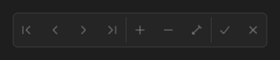

# DataNavigator



Navegador: primeiro, anterior, próximo, último, incluir, excluir, editar, gravar e cancelar. Os botões se habilitam conforme o estado do dataset. Erros (por exemplo um campo obrigatório no `post`) disparam `on_error`.

**Paleta:** Data Controls · **controle visual** · também tem as [propriedades e eventos comuns a todo controle](controles.md)

## Propriedades

### Dados

| Propriedade | No Object Inspector | Tipo |
|---|---|---|
| `data_source` | Fonte de dados | componente |

## Eventos

| Evento | Quando | No Object Inspector | Pergunta |
|---|---|---|---|
| `before_action` | — | Antes da ação | sim (recusar com a exceção) |
| `on_error` | — | — |  |

## Em código

No form, o `DataNavigator1` com o evento ligado (no Object Inspector, na aba Eventos):

```json
{ "class": "DataNavigator", "name": "DataNavigator1", "before_action": "data_navigator1_before_action" }
```

E o handler, um método do form (`self.DataNavigator1` já é um `DataNavigator`):

```rust
impl FrmPrincipal {
    pub fn data_navigator1_before_action(&mut self, ui: &mut Ui, _sender: ComponentId, _args: &EventArgs) {
        let _ = &self.DataNavigator1;
    }
}
```
