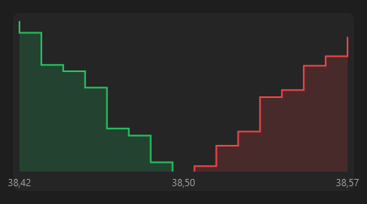

# DepthChart



Gráfico de profundidade: compras acumuladas (verde, à esquerda do meio) e vendas acumuladas (vermelho, à direita), em degraus; o cursor mostra preço e acumulado.

**Paleta:** Trader · **controle visual** · também tem as [propriedades e eventos comuns a todo controle](controles.md)

## Propriedades

### Aparência

| Propriedade | No Object Inspector | Tipo | O que faz |
|---|---|---|---|
| `decimals` | Casas decimais | inteiro |  |

### Dados

| Propriedade | No Object Inspector | Tipo | O que faz |
|---|---|---|---|
| `bids` | Ofertas de compra | texto |  |
| `asks` | Ofertas de venda | texto |  |

## Em código

No form, o `DepthChart1` com o evento ligado (no Object Inspector, na aba Eventos):

```json
{ "class": "DepthChart", "name": "DepthChart1" }
```

E o handler, um método do form (`self.DepthChart1` já é um `DepthChart`):

```rust
impl FrmPrincipal {
    pub fn form_show(&mut self, ui: &mut Ui, _sender: ComponentId, _args: &EventArgs) {
        let atual = self.DepthChart1.bids(ui);
        self.DepthChart1.set_bids(ui, format!("{atual}!"));
    }
}
```

(Sem eventos próprios: o exemplo usa o `on_show` do form.)
