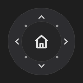

# DirectionPad



Direcional redondo (controle PTZ de câmera, joystick): oito direções e o centro. Apertar dispara `on_press` com a direção ("up", "down_left", "center"...) e soltar, `on_release`. `diagonals = false` deixa só as quatro principais.

**Paleta:** Additional · **controle visual** · também tem as [propriedades e eventos comuns a todo controle](controles.md)

## Propriedades

### Aparência

| Propriedade | No Object Inspector | Tipo | O que faz |
|---|---|---|---|
| `center_icon` | Ícone do centro | texto | Ícone do botão do meio (vazio = sem botão). |

### Comportamento

| Propriedade | No Object Inspector | Tipo | O que faz |
|---|---|---|---|
| `diagonals` | Diagonais | lógico | Aceita as quatro diagonais; desligado, só cima, baixo, esquerda e direita. |

## Eventos

| Evento | Quando | No Object Inspector | Pergunta |
|---|---|---|---|
| `on_press` | — | — |  |
| `on_release` | — | — |  |

## Em código

No form, o `DirectionPad1` com o evento ligado (no Object Inspector, na aba Eventos):

```json
{ "class": "DirectionPad", "name": "DirectionPad1", "on_press": "direction_pad1_press" }
```

E o handler, um método do form (`self.DirectionPad1` já é um `DirectionPad`):

```rust
impl FrmPrincipal {
    pub fn direction_pad1_press(&mut self, ui: &mut Ui, _sender: ComponentId, _args: &EventArgs) {
        let atual = self.DirectionPad1.diagonals(ui);
        self.DirectionPad1.set_diagonals(ui, !atual);
    }
}
```
