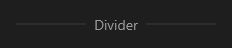

# Divider



Linha divisória (o `v-divider`), horizontal ou vertical, com texto no meio opcional.

**Paleta:** Layouts · **controle visual** · também tem as [propriedades e eventos comuns a todo controle](controles.md)

## Propriedades

### Aparência

| Propriedade | No Object Inspector | Tipo | O que faz |
|---|---|---|---|
| `vertical` | Vertical | lógico | A linha em pé (divide colunas) em vez de deitada. |
| `text` | Texto | texto | Texto no meio da linha; vazio: só a linha. |
| `thickness` | Espessura | número | Espessura da linha, em pontos. |

## Em código

No form, o `Divider1` com o evento ligado (no Object Inspector, na aba Eventos):

```json
{ "class": "Divider", "name": "Divider1" }
```

E o handler, um método do form (`self.Divider1` já é um `Divider`):

```rust
impl FrmPrincipal {
    pub fn form_show(&mut self, ui: &mut Ui, _sender: ComponentId, _args: &EventArgs) {
        let atual = self.Divider1.vertical(ui);
        self.Divider1.set_vertical(ui, !atual);
    }
}
```

(Sem eventos próprios: o exemplo usa o `on_show` do form.)
