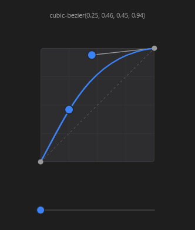

# EasingEditor



Editor da curva de suavização (o de `cubic-bezier` do DevTools): arraste os dois pontos de controle; o `y` pode passar de 0..1 (curvas que "passam do ponto"). Embaixo, uma bolinha mostra o movimento com a curva. `compact` desenha só a curva (para miniaturas).

**Paleta:** Additional · **controle visual** · também tem as [propriedades e eventos comuns a todo controle](controles.md)

## Propriedades

### Aparência

| Propriedade | No Object Inspector | Tipo |
|---|---|---|
| `preview` | Prévia | lógico |
| `compact` | Compacto | lógico |

### Dados

| Propriedade | No Object Inspector | Tipo |
|---|---|---|
| `x1` | X1 da curva | número |
| `y1` | Y1 da curva | número |
| `x2` | X2 da curva | número |
| `y2` | Y2 da curva | número |

## Eventos

| Evento | Quando | No Object Inspector | Pergunta |
|---|---|---|---|
| `on_change` | o valor mudou (pelo usuário ou pelo código, como na VCL) | — |  |
| `on_commit` | — | — |  |

## Em código

No form, o `EasingEditor1` com o evento ligado (no Object Inspector, na aba Eventos):

```json
{ "class": "EasingEditor", "name": "EasingEditor1", "on_change": "easing_editor1_change" }
```

E o handler, um método do form (`self.EasingEditor1` já é um `EasingEditor`):

```rust
impl FrmPrincipal {
    pub fn easing_editor1_change(&mut self, ui: &mut Ui, _sender: ComponentId, _args: &EventArgs) {
        let atual = self.EasingEditor1.x1(ui);
        self.EasingEditor1.set_x1(ui, atual + 10.0);
    }
}
```
