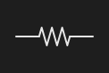

# ElectricalSymbol



Um símbolo elétrico (o diagrama, na horizontal; gire pelo `rotation`). `state` liga a chave, o relé, a lâmpada e o LED; `label` é o valor (`10 kΩ`, `24 V`). Os terminais ficam nos lados esquerdo e direito (os `Wire` prendem ali).

**Paleta:** Electrical · **controle visual** · também tem as [propriedades e eventos comuns a todo controle](controles.md)

## Propriedades

### Aparência

| Propriedade | No Object Inspector | Tipo | O que faz |
|---|---|---|---|
| `symbol` | Símbolo | um de: `resistor`, `capacitor`, `inductor`, `diode`, `led`, `transistor`, `source`, `ground`, `switch`, `relay`, `lamp`, `motor` |  |
| `label` | Rótulo | texto |  |

### Dados

| Propriedade | No Object Inspector | Tipo | O que faz |
|---|---|---|---|
| `state` | Estado | lógico |  |

## Em código

No form, o `ElectricalSymbol1` com o evento ligado (no Object Inspector, na aba Eventos):

```json
{ "class": "ElectricalSymbol", "name": "ElectricalSymbol1" }
```

E o handler, um método do form (`self.ElectricalSymbol1` já é um `ElectricalSymbol`):

```rust
impl FrmPrincipal {
    pub fn form_show(&mut self, ui: &mut Ui, _sender: ComponentId, _args: &EventArgs) {
        let atual = self.ElectricalSymbol1.state(ui);
        self.ElectricalSymbol1.set_state(ui, !atual);
    }
}
```

(Sem eventos próprios: o exemplo usa o `on_show` do form.)
