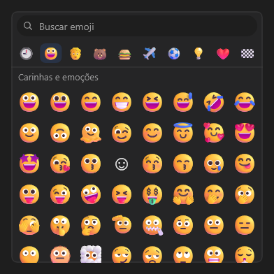

# EmojiPicker



Seletor de emoji. Tocar num emoji dispara `on_select` (o emoji em `EventArgs::Text`) e o põe nos recentes (`recent`, separados por espaço; o app pode guardar e devolver).

**Paleta:** Additional · **controle visual** · também tem as [propriedades e eventos comuns a todo controle](controles.md)

## Propriedades

### Comportamento

| Propriedade | No Object Inspector | Tipo | O que faz |
|---|---|---|---|
| `max_recent` | Máximo de recentes | inteiro | Quantos recentes guardar. |

### Dados

| Propriedade | No Object Inspector | Tipo | O que faz |
|---|---|---|---|
| `filter` | Filtro | texto | A busca (o campo de cima; também dá para mudar pelo código). |
| `recent` | Recentes | texto |  |

## Eventos

| Evento | Quando | No Object Inspector | Pergunta |
|---|---|---|---|
| `on_select` | — | — |  |

## Em código

No form, o `EmojiPicker1` com o evento ligado (no Object Inspector, na aba Eventos):

```json
{ "class": "EmojiPicker", "name": "EmojiPicker1", "on_select": "emoji_picker1_select" }
```

E o handler, um método do form (`self.EmojiPicker1` já é um `EmojiPicker`):

```rust
impl FrmPrincipal {
    pub fn emoji_picker1_select(&mut self, ui: &mut Ui, _sender: ComponentId, _args: &EventArgs) {
        let atual = self.EmojiPicker1.filter(ui);
        self.EmojiPicker1.set_filter(ui, format!("{atual}!"));
    }
}
```
