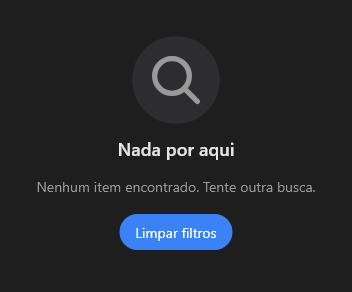

# EmptyState



Tela vazia (o `v-empty-state`): ícone grande, título, texto e um botão de ação (`on_action`). "Nenhum resultado", "Sem conexão", "Comece criando um item".

**Paleta:** Additional · **controle visual** · também tem as [propriedades e eventos comuns a todo controle](controles.md)

## Propriedades

### Aparência

| Propriedade | No Object Inspector | Tipo |
|---|---|---|
| `icon` | Ícone | texto |
| `title` | Título | texto |
| `text` | Texto | texto |
| `action` | Ação | texto |

## Eventos

| Evento | Quando | No Object Inspector | Pergunta |
|---|---|---|---|
| `on_action` | — | — |  |

## Em código

No form, o `EmptyState1` com o evento ligado (no Object Inspector, na aba Eventos):

```json
{ "class": "EmptyState", "name": "EmptyState1", "on_action": "empty_state1_action" }
```

E o handler, um método do form (`self.EmptyState1` já é um `EmptyState`):

```rust
impl FrmPrincipal {
    pub fn empty_state1_action(&mut self, ui: &mut Ui, _sender: ComponentId, _args: &EventArgs) {
        let atual = self.EmptyState1.icon(ui);
        self.EmptyState1.set_icon(ui, format!("{atual}!"));
    }
}
```
