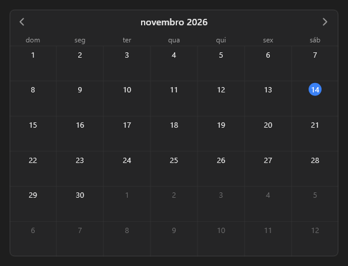

# EventCalendar



Calendário de eventos (o `v-calendar`): vista de mês, semana ou dia (`view`). `events` separados por `;`, cada um `2026-10-25|Reunião|success` (o dia todo) ou `2026-10-25 14:00-15:30|Reunião|success` (com horário; a cor é opcional). `date` é o dia de referência (vazio = hoje); as setas andam um mês, uma semana ou um dia. Eventos: `on_day` (data ISO), `on_event` (`data|título`) e `on_slot` (`data HH:00`, o horário vazio clicado na semana ou no dia).

**Paleta:** Additional · **controle visual** · também tem as [propriedades e eventos comuns a todo controle](controles.md)

## Propriedades

### Aparência

| Propriedade | No Object Inspector | Tipo | O que faz |
|---|---|---|---|
| `view` | Visão | um de: `month`, `week`, `day` | A vista: `month` (o mês), `week` (a semana com as horas) ou `day` (um dia). |
| `start_hour` | Hora inicial | inteiro | A primeira hora mostrada nas vistas de semana e de dia (0 a 23). |
| `end_hour` | Hora final | inteiro | A hora em que as vistas de semana e de dia terminam (até 24). |

### Dados

| Propriedade | No Object Inspector | Tipo | O que faz |
|---|---|---|---|
| `date` | Data | texto | O dia de referência (ISO, `2026-10-25`): o mês, a semana ou o dia mostrado. Vazio = hoje. |
| `month` | Mês | texto | Mês mostrado (`2026-10`): o mesmo que `date` no dia 1 (mantido para compatibilidade). |
| `events` | Eventos | texto | Os eventos, separados por `;`: `2026-10-25\|Reunião\|success` (o dia todo) ou `2026-10-25 14:00-15:30\|Reunião\|success` (com horário; a cor é opcional). |

## Eventos

| Evento | Quando | No Object Inspector | Pergunta |
|---|---|---|---|
| `on_day` | — | — |  |
| `on_event` | — | — |  |
| `on_slot` | — | — |  |

## Em código

No form, o `EventCalendar1` com o evento ligado (no Object Inspector, na aba Eventos):

```json
{ "class": "EventCalendar", "name": "EventCalendar1", "on_day": "event_calendar1_day" }
```

E o handler, um método do form (`self.EventCalendar1` já é um `EventCalendar`):

```rust
impl FrmPrincipal {
    pub fn event_calendar1_day(&mut self, ui: &mut Ui, _sender: ComponentId, _args: &EventArgs) {
        let atual = self.EventCalendar1.date(ui);
        self.EventCalendar1.set_date(ui, format!("{atual}!"));
    }
}
```
